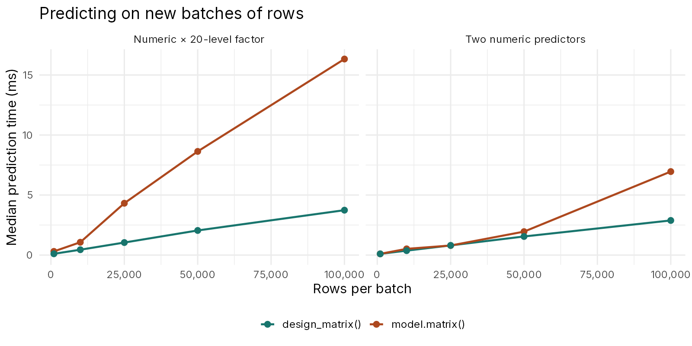
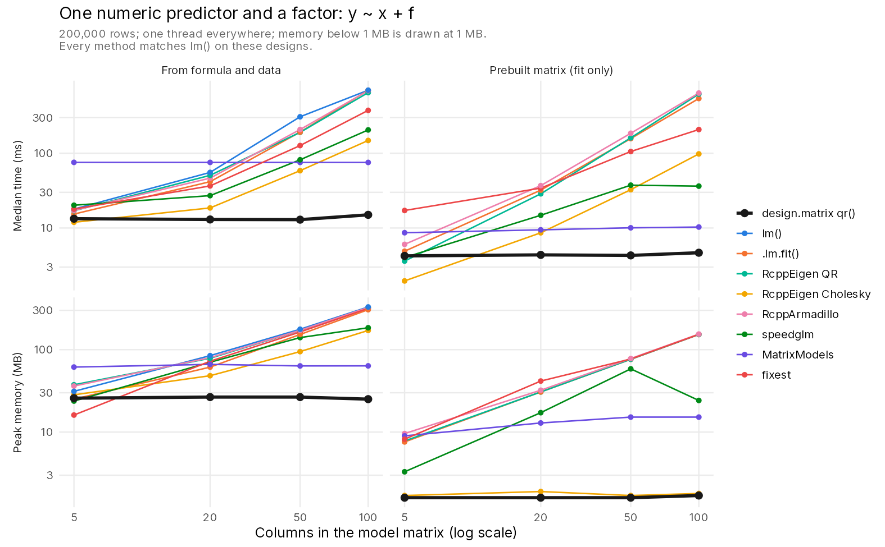
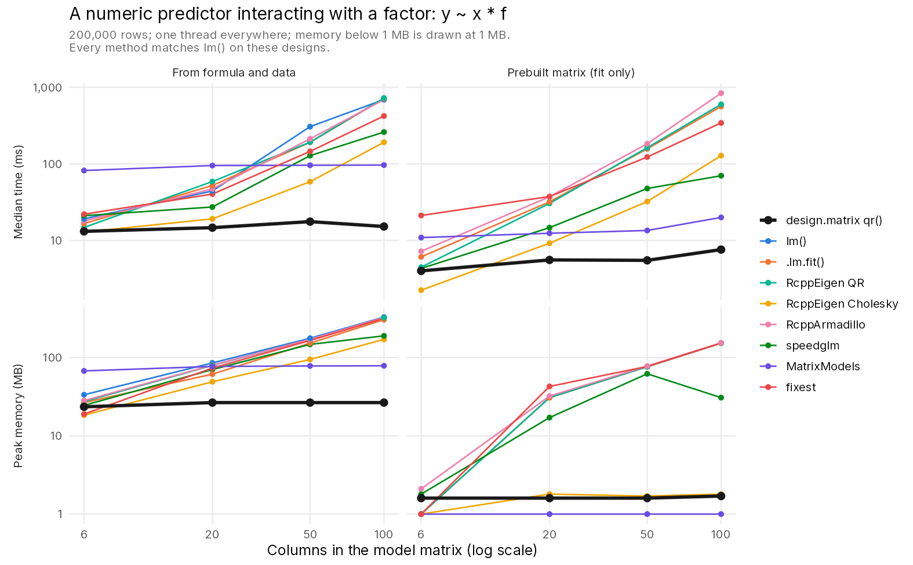
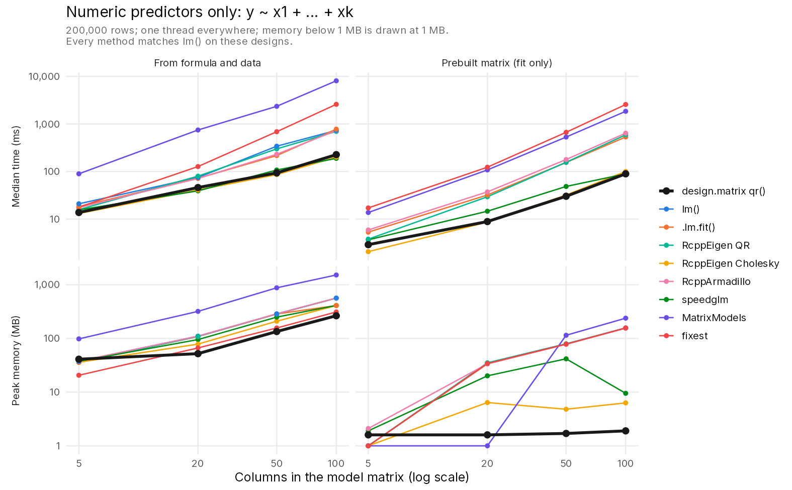
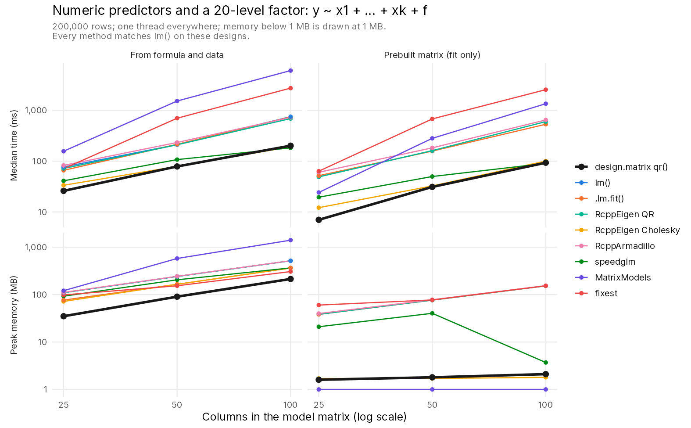

# design.matrix

## Introduction

The `design.matrix` package builds model matrices that are identical, bit for bit, to those returned by `stats::model.matrix()`. Its main benefit comes when the dense model matrix is only an intermediate input to something else: least squares coefficients need `X'X` and `X'y`, predictions multiply it by a vector of coefficients, their standard errors need a quadratic form, and cluster-robust variances need weighted sums of its rows by group. `design.matrix` computes these results directly from the factor codes and numeric variables, without materializing the dense matrix, which often saves an order of magnitude or more in both time and memory. When the dense matrix itself is what you need, there is no step to skip, and the gains are much smaller.

Use `design.matrix` when you have a formula (or fitted model) and data, and you need the model matrix only on the way to something else, so that allocating, filling, and storing it would be wasted work. If you already have the dense matrix `X`, use it directly.

``` r
# install.packages("remotes")
remotes::install_github("vincentarelbundock/design.matrix")
```

How much time can you save when predicting on a new batch? The plot compares two numeric predictors with a numeric predictor interacting with a 20-level factor. Both methods reuse the fitted model’s terms, factor coding, and coefficients. Timing starts after one-time setup and includes multiplying by the coefficients. The package uses one thread.

<details class="code-fold">
<summary>Show benchmark code</summary>

``` r
library(design.matrix)
library(ggplot2)
design_threads(1)
set.seed(27)

n <- 100000
d <- data.frame(x = rnorm(n), z = rnorm(n), region = factor(sample(1:20, n, replace = TRUE)))
train <- data.frame(x = rnorm(5000), z = rnorm(5000), region = factor(sample(1:20, 5000, replace = TRUE)))
train$y <- rnorm(nrow(train))
time_model <- function(formula) {
    fit <- lm(formula, train)
    tt <- delete.response(terms(fit))
    spec <- design_matrix(fit, newdata = NULL)
    beta <- coef(fit)

    base_predict <- function(batch) {
        mf <- model.frame(tt, batch, xlev = fit$xlevels)
        X <- model.matrix(tt, mf, contrasts.arg = fit$contrasts)
        drop(X %*% beta)
    }

    fast_predict <- function(batch) {
        D <- design_matrix(spec, batch)
        drop(D %*% beta)
    }

    time_batch <- function(n) {
        batch <- head(d, n)
        timings <- bench::mark(
            base_predict(batch), fast_predict(batch),
            iterations = 15, memory = FALSE, filter_gc = FALSE,
            check = function(a, b) isTRUE(all.equal(as.numeric(a), as.numeric(b))))
        data.frame(rows = n, ms = 1000 * as.numeric(timings$median),
                   method = c("model.matrix()", "design_matrix()"))
    }

    do.call(rbind, lapply(c(1000, 10000, 25000, 50000, 100000), time_batch))
}

times <- rbind(
    transform(time_model(y ~ x + z), model = "Two numeric predictors"),
    transform(time_model(y ~ x * region), model = "Numeric × 20-level factor"))
p <- ggplot(times, aes(rows, ms, colour = method)) +
    geom_line(linewidth = 1) + geom_point(size = 2.5) +
    facet_wrap(~ model) +
    expand_limits(y = 0) +
    scale_x_continuous(labels = scales::label_comma()) +
    scale_colour_manual(values = c("model.matrix()" = "#ad481e", "design_matrix()" = "#18756d")) +
    labs(title = "Predicting on new batches of rows",
         x = "Rows per batch", y = "Median prediction time (ms)", colour = NULL) +
    theme_minimal(base_size = 14) + theme(legend.position = "bottom")
ggsave("prediction-batch-timing.png", p, width = 10, height = 5, dpi = 160, bg = "white")
```

</details>



The plot measures only time, and only for predictions. The savings extend to memory and to other common tasks. On data with 200,000 rows and 119 columns, on one thread:

| Task | Base R | `design.matrix` |
|----|----|----|
| Predictions on new data | 123ms, 388MB | 9.5ms, 3.12MB |
| Standard errors of predictions | 361ms, 940MB | 17ms, 9.67MB |
| Grouped weighted sums (cluster-robust variance) | 121ms, 397MB | 28.3ms, 37.2MB |
| Sparse model matrix (vs. `Matrix::sparse.model.matrix()`) | 447ms, 662MB | 28.3ms, 40.7MB |

Each of these tasks uses the model matrix only as an intermediate input, so `design.matrix` never forms it. When you do need the dense matrix, `design.matrix` returns the identical matrix at about the same speed on one thread and about twice as fast on four threads, but it takes the same memory. The benchmarks below give the details.

### Promises

1.  **Exact.** Model matrices and those from `model.matrix()` pass `identical(a, b, num.eq = FALSE, single.NA = FALSE, attrib.as.set = FALSE)`, the strictest comparison R offers: same bits (signed zeros and `NA`/`NaN` payloads included), attributes in the same order, and the same warnings and errors, for any number of threads.
2.  **New data.** A design built from a fitted model uses the same columns, factor coding, and transformations that the model uses for prediction.
3.  **Algebra.** Products and sums computed without the dense matrix agree with the dense computation up to floating point rounding, with `NA` and `NaN` in the same places.
4.  **Sparse.** Sparse model matrices hold the same non-zero values as the dense ones, bit for bit.

The test suite checks these on hundreds of random formulas and data sets.

### Performance

Under the hood, a design matrix stores only the factor codes, the numeric variables and the contrast matrices, which can take much less memory than the dense matrix. Products, sums and quadratic forms are computed by C kernels that read each row’s few non-zero entries straight from these inputs, optionally on several threads, and rows with identical inputs can be computed once. When the dense matrix is needed, it is filled by a multi-threaded port of R’s own C routine.

Each section shows a small example, checked with `identical()` when the result is exact and with `all.equal()` when sums run in a different order, followed by a benchmark on medium-sized data (200,000 rows, 119 columns). The relative costs depend on the size and structure of the design.

The benchmark tables report minimum and median elapsed time and `mem_alloc`, the total bytes allocated on the R heap during one evaluation. Reproducing the memory column requires an R build with `capabilities("profmem")` enabled. For fair comparisons with functions that call `model.matrix()`, the benchmarks set `options(design.matrix.skip_na_copy = FALSE)`, so that the model frame is built in exactly the same way (by default, `design.matrix` skips a copy of the frame that `na.omit()` makes even when no row has a missing value).

### Simple example

Build a design with an intercept, a numeric predictor, and a two-level factor. Multiplying it by a coefficient vector gives one linear prediction per row.

``` r
library(design.matrix)

d <- data.frame(x = c(1, 2, 3), group = factor(c("a", "b", "a")))
D <- design_matrix(~ x + group, d)
beta <- c("(Intercept)" = 10, x = 2, groupb = -1)
drop(D %*% beta)
#> [1] 12 13 16

newdata <- data.frame(x = c(4, 5), group = "a")
D_new <- design_matrix(D, newdata)
drop(D_new %*% beta)
#> [1] 18 20
```

## Operations

### `design_matrix()`

A design matrix holds the prepared variables and the layout of the columns, but not the dense matrix. `as.matrix()` builds the latter.

``` r
library(design.matrix)
d <- data.frame(
    y = c(0.3, -1.2, 0.8, 1.5, -0.4, 0.9, -2.1, 0.2),
    x = c(-1.5, 0.2, 1.1, -0.3, 2.0, 0.7, -0.9, 1.4),
    f = factor(c("a", "b", "c", "a", "b", "c", "a", "b")),
    cl = c(1, 1, 2, 2, 3, 3, 4, 4))

D <- design_matrix(y ~ x * f, d)
D
#> <design_matrix: 8 rows x 6 columns>
#> columns: (Intercept), x, fb, fc, x:fb, x:fc

a <- model.matrix(y ~ x * f, d)
b <- as.matrix(D)
identical(a, b, num.eq = FALSE)
#> [1] TRUE
```

The following construction benchmark uses one thread. Building the design defers the cost of allocating and filling the dense matrix until `as.matrix()` is called; the next section times that step.

``` r
library(design.matrix)
design_threads(1)
options(design.matrix.dedup = FALSE)
set.seed(1)
n <- 2e5
big <- data.frame(
    y = rnorm(n),
    x = rnorm(n),
    f1 = factor(sample(sprintf("a%02d", 1:50), n, TRUE)),
    f2 = factor(sample(letters[1:20], n, TRUE)),
    cl = sample(1:1000, n, TRUE))
fo <- y ~ x * f1 + f2

bench::mark(
    "stats::model.matrix" = model.matrix(fo, big),
    "design_matrix"       = design_matrix(fo, big),
    iterations = 10, check = FALSE)[c("expression", "min", "median", "mem_alloc")]
#> # A tibble: 2 × 4
#>   expression               min   median mem_alloc
#>   <bch:expr>          <bch:tm> <bch:tm> <bch:byt>
#> 1 stats::model.matrix  52.26ms   52.6ms   211.1MB
#> 2 design_matrix         9.97ms   10.2ms    29.6MB
```

### Using multiple threads with `as.matrix()`

Writing the dense output accounts for much of the work in both implementations. Additional threads can speed things up (see `design_threads()`). The memory column includes both the dense output and temporary allocations made while building it.

``` r
library(design.matrix)
options(design.matrix.dedup = FALSE)
set.seed(1)
n <- 2e5
big <- data.frame(
    y = rnorm(n),
    x = rnorm(n),
    f1 = factor(sample(sprintf("a%02d", 1:50), n, TRUE)),
    f2 = factor(sample(letters[1:20], n, TRUE)),
    cl = sample(1:1000, n, TRUE))
fo <- y ~ x * f1 + f2
same <- function(a, b) identical(a, b, num.eq = FALSE, single.NA = FALSE, attrib.as.set = FALSE)

fast_model_matrix <- function(formula, data, threads) {
    design_threads(threads)
    as.matrix(design_matrix(formula, data))
}

bench::mark(
    model.matrix(fo, big),
    fast_model_matrix(fo, big, threads = 1),
    fast_model_matrix(fo, big, threads = 4),
    iterations = 10, check = same)[c("expression", "min", "median", "mem_alloc")]
#> # A tibble: 3 × 4
#>   expression                                   min   median mem_alloc
#>   <bch:expr>                              <bch:tm> <bch:tm> <bch:byt>
#> 1 model.matrix(fo, big)                     52.9ms   52.9ms     211MB
#> 2 fast_model_matrix(fo, big, threads = 1)   51.3ms   51.5ms     211MB
#> 3 fast_model_matrix(fo, big, threads = 4)     23ms   23.3ms     211MB
design_threads(1)
```

### Reusing a design on new data

To make predictions, new rows must be turned into columns exactly as the training rows were. Here, `poly(x, 2)` must use the training polynomial, and `f` must keep one column per training level even though the new data only contain `"b"`. Pass the training design and the new data to `design_matrix()`, then use `as.matrix()` to display the columns.

``` r
library(design.matrix)
d <- data.frame(
    y = c(0.3, -1.2, 0.8, 1.5, -0.4, 0.9, -2.1, 0.2),
    x = c(-1.5, 0.2, 1.1, -0.3, 2.0, 0.7, -0.9, 1.4),
    f = factor(c("a", "b", "c", "a", "b", "c", "a", "b")),
    cl = c(1, 1, 2, 2, 3, 3, 4, 4))

D <- design_matrix(y ~ poly(x, 2) + f, d)
nd <- data.frame(x = c(0, 1), f = "b")
as.matrix(design_matrix(D, nd))
#>   (Intercept) poly(x, 2)1 poly(x, 2)2 fb fc
#> 1           1  -0.1070552  -0.3717871  1  0
#> 2           1   0.2101455  -0.2062446  1  0
#> attr(,"assign")
#> [1] 0 1 1 2 2
#> attr(,"contrasts")
#> attr(,"contrasts")$f
#> [1] "contr.treatment"
```

A fitted model works too, and gives the same result:

``` r
fit <- lm(y ~ poly(x, 2) + f, d)
identical(as.matrix(design_matrix(D, nd)), as.matrix(design_matrix(fit, newdata = nd)), num.eq = FALSE)
#> [1] TRUE
```

When you have many batches, prepare once with `spec <- design_matrix(fit, newdata = NULL)`, then call `design_matrix(spec, batch)` for each batch. The benchmark below does this for a 100-row batch.

``` r
library(design.matrix)
options(design.matrix.dedup = FALSE)
set.seed(1)
n <- 2e5
big <- data.frame(
    y = rnorm(n),
    x = rnorm(n),
    f1 = factor(sample(sprintf("a%02d", 1:50), n, TRUE)),
    f2 = factor(sample(letters[1:20], n, TRUE)),
    cl = sample(1:1000, n, TRUE))
fo <- y ~ x * f1 + f2
same <- function(a, b) identical(a, b, num.eq = FALSE, single.NA = FALSE, attrib.as.set = FALSE)

fit <- lm(fo, big)
spec <- design_matrix(fit, newdata = NULL)
tt <- delete.response(terms(fit))
nd <- big[1:100, ]
base_model_matrix <- function(batch) {
    mf <- model.frame(tt, batch, xlev = fit$xlevels, na.action = na.pass)
    model.matrix(tt, mf, contrasts.arg = fit$contrasts)
}
fast_model_matrix <- function(batch) {
    as.matrix(design_matrix(spec, batch))
}

bench::mark(
    base_model_matrix(nd),
    fast_model_matrix(nd),
    iterations = 200, check = same)[c("expression", "min", "median", "mem_alloc")]
#> # A tibble: 2 × 4
#>   expression                 min   median mem_alloc
#>   <bch:expr>            <bch:tm> <bch:tm> <bch:byt>
#> 1 base_model_matrix(nd)  294.2µs  336.7µs   224.1KB
#> 2 fast_model_matrix(nd)   26.2µs   27.3µs    94.4KB
```

### Arithmetic

Multiply or divide a design matrix by a number to scale it, or by a vector to scale each row. You can also add or subtract two designs with matching rows and columns. The result is another design matrix.

``` r
library(design.matrix)
D <- design_matrix(~ x, data.frame(x = c(2, 3)))
as.matrix(c(1, 2) * D)
#>   (Intercept) x
#> 1           1 2
#> 2           2 6
```

### `%*%`

`D %*% B` computes `X B` from the factor codes and numeric variables. `B` can have several columns.

``` r
library(design.matrix)
d <- data.frame(
    y = c(0.3, -1.2, 0.8, 1.5, -0.4, 0.9, -2.1, 0.2),
    x = c(-1.5, 0.2, 1.1, -0.3, 2.0, 0.7, -0.9, 1.4),
    f = factor(c("a", "b", "c", "a", "b", "c", "a", "b")),
    cl = c(1, 1, 2, 2, 3, 3, 4, 4))
D <- design_matrix(y ~ x * f, d)

M <- model.matrix(y ~ x * f, d)
beta <- c(1, 0.5, -1, 2, 0.1, 0.3)

a <- M %*% beta
b <- D %*% beta
all.equal(a, b, check.attributes = FALSE)
#> [1] TRUE
```

The benchmarks in this section and the following ones time each operation in two situations. Starting from the data, both sides build their matrix and then use it once, as when predicting on new data. Starting from a prebuilt matrix (`X` or `DX`, built in the setup), only the operation is timed, as when the same matrix is reused; the prebuilt design typically uses less memory than the dense matrix.

``` r
library(design.matrix)
options(design.matrix.dedup = FALSE)
set.seed(1)
n <- 2e5
big <- data.frame(
    y = rnorm(n),
    x = rnorm(n),
    f1 = factor(sample(sprintf("a%02d", 1:50), n, TRUE)),
    f2 = factor(sample(letters[1:20], n, TRUE)),
    cl = sample(1:1000, n, TRUE))
fo <- y ~ x * f1 + f2
X <- model.matrix(fo, big)
DX <- design_matrix(fo, big)
flat <- function(v) unname(c(unlist(v)))
close <- function(a, b) isTRUE(all.equal(flat(a), flat(b)))

beta <- rnorm(ncol(X))
bench::mark(
    "model.matrix, then %*%"  = model.matrix(fo, big) %*% beta,
    "design_matrix, then %*%" = design_matrix(fo, big) %*% beta,
    "prebuilt X"              = X %*% beta,
    "prebuilt design matrix"  = DX %*% beta,
    iterations = 10, check = close)[c("expression", "min", "median", "mem_alloc")]
#> # A tibble: 4 × 4
#>   expression                   min   median mem_alloc
#>   <bch:expr>              <bch:tm> <bch:tm> <bch:byt>
#> 1 model.matrix, then %*%   67.62ms  68.41ms  212.67MB
#> 2 design_matrix, then %*%  19.16ms  19.38ms    31.1MB
#> 3 prebuilt X               14.64ms  14.81ms    1.53MB
#> 4 prebuilt design matrix    8.83ms   8.98ms    1.54MB
```

### `crossprod()`

`crossprod(D, W)` computes `X'W`, such as `X'y` in least squares or weighted sums of the columns of `X`. `crossprod(D)` computes `X'X`, and `crossprod(D, w * D)` the weighted `X'WX`; both return ordinary matrices, which go straight to `chol()`, `chol2inv()`, `eigen()` or `solve()`.

``` r
library(design.matrix)
d <- data.frame(
    y = c(0.3, -1.2, 0.8, 1.5, -0.4, 0.9, -2.1, 0.2),
    x = c(-1.5, 0.2, 1.1, -0.3, 2.0, 0.7, -0.9, 1.4),
    f = factor(c("a", "b", "c", "a", "b", "c", "a", "b")),
    cl = c(1, 1, 2, 2, 3, 3, 4, 4))
M <- model.matrix(y ~ x * f, d)
D <- design_matrix(y ~ x * f, d)

w <- seq(-1, 1, length.out = 8)

a <- crossprod(M, w)
b <- crossprod(D, w)
all.equal(a, b, check.attributes = FALSE)
#> [1] TRUE

all.equal(crossprod(M), crossprod(D))
#> [1] TRUE
all.equal(crossprod(M, w * M), crossprod(D, w * D))
#> [1] TRUE
```

``` r
library(design.matrix)
options(design.matrix.dedup = FALSE)
set.seed(1)
n <- 2e5
big <- data.frame(
    y = rnorm(n),
    x = rnorm(n),
    f1 = factor(sample(sprintf("a%02d", 1:50), n, TRUE)),
    f2 = factor(sample(letters[1:20], n, TRUE)),
    cl = sample(1:1000, n, TRUE))
fo <- y ~ x * f1 + f2
X <- model.matrix(fo, big)
DX <- design_matrix(fo, big)
flat <- function(v) unname(c(unlist(v)))
close <- function(a, b) isTRUE(all.equal(flat(a), flat(b)))

w <- rnorm(n)
bench::mark(
    "model.matrix, then crossprod"  = crossprod(model.matrix(fo, big), w),
    "design_matrix, then crossprod" = crossprod(design_matrix(fo, big), w),
    "prebuilt X"                    = crossprod(X, w),
    "prebuilt design matrix"        = crossprod(DX, w),
    iterations = 10, check = close)[c("expression", "min", "median", "mem_alloc")]
#> # A tibble: 4 × 4
#>   expression                         min   median mem_alloc
#>   <bch:expr>                    <bch:tm> <bch:tm> <bch:byt>
#> 1 model.matrix, then crossprod   67.72ms  68.31ms  211.14MB
#> 2 design_matrix, then crossprod  19.24ms  19.59ms    31.1MB
#> 3 prebuilt X                     14.41ms  14.53ms     1000B
#> 4 prebuilt design matrix          9.21ms   9.42ms    1.54MB
```

For `X'X`, the design matrix adds up the products of each row’s few non-zero entries, instead of all `p^2 / 2` products of the dense row.

``` r
library(design.matrix)
options(design.matrix.dedup = FALSE)
set.seed(1)
n <- 2e5
big <- data.frame(
    y = rnorm(n),
    x = rnorm(n),
    f1 = factor(sample(sprintf("a%02d", 1:50), n, TRUE)),
    f2 = factor(sample(letters[1:20], n, TRUE)),
    cl = sample(1:1000, n, TRUE))
fo <- y ~ x * f1 + f2
X <- model.matrix(fo, big)
DX <- design_matrix(fo, big)
flat <- function(v) unname(c(unlist(v)))
close <- function(a, b) isTRUE(all.equal(flat(a), flat(b)))

bench::mark(
    "model.matrix, then crossprod"  = crossprod(model.matrix(fo, big)),
    "design_matrix, then crossprod" = crossprod(design_matrix(fo, big)),
    "prebuilt X"                    = crossprod(X),
    "prebuilt design matrix"        = crossprod(DX),
    iterations = 10, check = close)[c("expression", "min", "median", "mem_alloc")]
```

### `qr()`

`qr(D)` decomposes a design matrix without forming `X` or `Q`, and the usual functions accept the result: `qr.coef()`, `qr.fitted()`, `qr.resid()`, `qr.qty()`, `qr.qy()`, `qr.Q()`, `qr.R()` and `solve()`. `R` is the Cholesky factor of `crossprod(D)`, with columns pivoted as in `qr()` and `lm()`, and `Q` is `X R^-1`, never formed. Coefficients are refined from the residuals `y - X b`, which recovers much of the accuracy that the normal equations lose on badly conditioned designs. Columns whose residual norm is close to the tolerance are checked against the data, so aliased columns are those of `qr()`.

Results agree with `qr(as.matrix(D))` up to floating point rounding, not bit for bit. Signs of the rows of `R` (and of the columns of `Q`) can differ, and `qr.Q()` and `qr.qty()` return only the first `rank` columns or rows, since the complete `Q` is never formed. See `?design_qr`.

``` r
library(design.matrix)
d <- data.frame(
    y = c(0.3, -1.2, 0.8, 1.5, -0.4, 0.9, -2.1, 0.2),
    x = c(-1.5, 0.2, 1.1, -0.3, 2.0, 0.7, -0.9, 1.4),
    f = factor(c("a", "b", "c", "a", "b", "c", "a", "b")),
    cl = c(1, 1, 2, 2, 3, 3, 4, 4))
M <- model.matrix(y ~ x * f, d)
D <- design_matrix(y ~ x * f, d)

a <- qr(M)
b <- qr(D)
b
#> <design_qr: 8 x 6 design, rank 6>
all.equal(qr.coef(a, d$y), qr.coef(b, d$y))
#> [1] TRUE
all.equal(qr.resid(a, d$y), qr.resid(b, d$y), check.attributes = FALSE)
#> [1] TRUE
all.equal(abs(qr.R(a)), abs(qr.R(b)), check.attributes = FALSE)
#> [1] TRUE
```

### `colSums()`, `colMeans()`, `rowSums()` and `rowMeans()`

The row and column summaries of base R work on design matrices. Pass one group label per row to `colSums()` or `colMeans()` to get one row per group, as with `base::rowsum()`. Group sums are a building block of cluster-robust standard errors and subgroup averages.

``` r
library(design.matrix)
d <- data.frame(site = c("B", "A", "B", "B", "A"), x = c(2, 10, 4, 6, 20))
D <- design_matrix(~ x, d)

colMeans(D)
#> (Intercept)           x 
#>         1.0         8.4
colSums(D, group = d$site)
#>   (Intercept)  x
#> A           2 30
#> B           3 12
colMeans(D, group = d$site)
#>   (Intercept)  x
#> A           1 15
#> B           1  4

all.equal(colSums(D, group = d$site), rowsum(model.matrix(~ x, d), d$site))
#> [1] TRUE
```

The benchmark computes weighted group sums. To weight the rows, multiply the design by a vector first.

``` r
library(design.matrix)
options(design.matrix.dedup = FALSE)
set.seed(1)
n <- 2e5
big <- data.frame(
    y = rnorm(n),
    x = rnorm(n),
    f1 = factor(sample(sprintf("a%02d", 1:50), n, TRUE)),
    f2 = factor(sample(letters[1:20], n, TRUE)),
    cl = sample(1:1000, n, TRUE))
fo <- y ~ x * f1 + f2
X <- model.matrix(fo, big)
DX <- design_matrix(fo, big)
flat <- function(v) unname(c(unlist(v)))
close <- function(a, b) isTRUE(all.equal(flat(a), flat(b)))

w <- rnorm(n)
bench::mark(
    "model.matrix, then rowsum"   = rowsum(w * model.matrix(fo, big), big$f2),
    "design_matrix, then colSums" = colSums(w * design_matrix(fo, big), group = big$f2),
    "prebuilt X"                  = rowsum(w * X, big$f2),
    "prebuilt design matrix"      = colSums(w * DX, group = big$f2),
    iterations = 10, check = close)[c("expression", "min", "median", "mem_alloc")]
#> # A tibble: 4 × 4
#>   expression                       min   median mem_alloc
#>   <bch:expr>                  <bch:tm> <bch:tm> <bch:byt>
#> 1 model.matrix, then rowsum      117ms  117.5ms     395MB
#> 2 design_matrix, then colSums     22ms   22.8ms      35MB
#> 3 prebuilt X                    63.4ms   65.3ms   183.9MB
#> 4 prebuilt design matrix        11.6ms   11.7ms     5.4MB
```

### `quadratic_diagonal()`

A common task is to extract the diagonal of `X V X'`. For example, in a linear regression context, with `V` the variance-covariance matrix of the coefficients and `X` the design matrix, the diagonal holds the variance of each fitted value, and its square root is the standard error. With `V = solve(crossprod(X))` instead, the diagonal holds the leverage of each observation. `quadratic_diagonal()` computes this diagonal without forming `X` or the full `n` by `n` product.

``` r
library(design.matrix)
d <- data.frame(
    y = c(0.3, -1.2, 0.8, 1.5, -0.4, 0.9, -2.1, 0.2),
    x = c(-1.5, 0.2, 1.1, -0.3, 2.0, 0.7, -0.9, 1.4),
    f = factor(c("a", "b", "c", "a", "b", "c", "a", "b")),
    cl = c(1, 1, 2, 2, 3, 3, 4, 4))
M <- model.matrix(y ~ x * f, d)
D <- design_matrix(y ~ x * f, d)

V <- diag(6) / 10

a <- rowSums((M %*% V) * M)
b <- quadratic_diagonal(D, V)
all.equal(a, b, check.attributes = FALSE)
#> [1] TRUE
```

Base R builds an `n` by `p` intermediate; the kernel touches only the non-zero entries of each row.

``` r
library(design.matrix)
options(design.matrix.dedup = FALSE)
set.seed(1)
n <- 2e5
big <- data.frame(
    y = rnorm(n),
    x = rnorm(n),
    f1 = factor(sample(sprintf("a%02d", 1:50), n, TRUE)),
    f2 = factor(sample(letters[1:20], n, TRUE)),
    cl = sample(1:1000, n, TRUE))
fo <- y ~ x * f1 + f2
X <- model.matrix(fo, big)
DX <- design_matrix(fo, big)
flat <- function(v) unname(c(unlist(v)))
close <- function(a, b) isTRUE(all.equal(flat(a), flat(b)))

V <- crossprod(matrix(rnorm(ncol(X)^2), ncol(X))) / ncol(X)
base_diagonal <- function(X, V) rowSums((X %*% V) * X)

bench::mark(
    base_diagonal(model.matrix(fo, big), V),
    quadratic_diagonal(design_matrix(fo, big), V),
    base_diagonal(X, V),
    quadratic_diagonal(DX, V),
    iterations = 5, check = close)[c("expression", "min", "median", "mem_alloc")]
#> # A tibble: 4 × 4
#>   expression                                         min   median mem_alloc
#>   <bch:expr>                                    <bch:tm> <bch:tm> <bch:byt>
#> 1 base_diagonal(model.matrix(fo, big), V)        182.2ms  189.1ms   575.8MB
#> 2 quadratic_diagonal(design_matrix(fo, big), V)     21ms   21.2ms    31.3MB
#> 3 base_diagonal(X, V)                            135.2ms  136.7ms   364.7MB
#> 4 quadratic_diagonal(DX, V)                       10.5ms   10.6ms     1.7MB
```

### Sparse model matrix

`as(D, "CsparseMatrix")` builds a sparse matrix without forming the dense one. It is identical to converting the dense model matrix.

``` r
library(design.matrix)
library(Matrix)
d <- data.frame(
    y = c(0.3, -1.2, 0.8, 1.5, -0.4, 0.9, -2.1, 0.2),
    x = c(-1.5, 0.2, 1.1, -0.3, 2.0, 0.7, -0.9, 1.4),
    f = factor(c("a", "b", "c", "a", "b", "c", "a", "b")),
    cl = c(1, 1, 2, 2, 3, 3, 4, 4))
M <- model.matrix(y ~ x * f, d)
D <- design_matrix(y ~ x * f, d)

dense_to_sparse <- function(M) as(as(as(M, "dMatrix"), "generalMatrix"), "CsparseMatrix")
a <- dense_to_sparse(M)
b <- as(D, "CsparseMatrix")
identical(a, b)
#> [1] TRUE
```

`Matrix::sparse.model.matrix()` and `MatrixModels::model.Matrix()` are shown for reference: they have their own rules for contrasts and column names. This benchmark uses a factor interaction and checks that all four methods produce the same dimensions and entries.

``` r
library(design.matrix)
library(Matrix)
library(MatrixModels)
options(design.matrix.dedup = FALSE)
set.seed(1)
n <- 2e5
big <- data.frame(
    y = rnorm(n),
    x = rnorm(n),
    f1 = factor(sample(sprintf("a%02d", 1:50), n, TRUE)),
    f2 = factor(sample(letters[1:20], n, TRUE)),
    cl = sample(1:1000, n, TRUE))
base_sparse <- function(formula, data) {
    X <- model.matrix(formula, data)
    as(as(as(X, "dMatrix"), "generalMatrix"), "CsparseMatrix")
}
fast_sparse <- function(formula, data) {
    D <- design_matrix(formula, data)
    as(D, "CsparseMatrix")
}

sfo <- y ~ x + f1 * f2
reference <- fast_sparse(sfo, big)
same_entries <- function(x) {
    identical(dim(x), dim(reference)) && Matrix::nnzero(x - reference) == 0
}
stopifnot(
    identical(base_sparse(sfo, big), reference),
    same_entries(Matrix::sparse.model.matrix(sfo, big)),
    same_entries(MatrixModels::model.Matrix(sfo, big, sparse = TRUE)))
bench::mark(
    base_sparse(sfo, big),
    fast_sparse(sfo, big),
    Matrix::sparse.model.matrix(sfo, big),
    MatrixModels::model.Matrix(sfo, big, sparse = TRUE),
    iterations = 5, check = FALSE)[c("expression", "min", "median", "mem_alloc")]
#> # A tibble: 4 × 4
#>   expression                                               min   median mem_alloc
#>   <bch:expr>                                          <bch:tm> <bch:tm> <bch:byt>
#> 1 base_sparse(sfo, big)                                  1.14s     1.3s    3.02GB
#> 2 fast_sparse(sfo, big)                                28.04ms   28.4ms   40.75MB
#> 3 Matrix::sparse.model.matrix(sfo, big)               379.19ms  445.4ms  661.52MB
#> 4 MatrixModels::model.Matrix(sfo, big, sparse = TRUE)  350.4ms    360ms  661.53MB
```

### Repeated rows

When rows have identical predictor values, `design.matrix` can compute the result once per distinct row and reuse it for every matching row. Row-wise results stay identical bit for bit. The option `design.matrix.dedup` controls this: `"auto"` (default), `TRUE` (always) or `FALSE` (never).

Repeated rows are found once per design matrix and remembered, so the first call pays for the search. The first two timings include design construction. The cached timing reuses both the design and its groups. Here, 5,000 patterns repeat over 200,000 rows.

``` r
library(design.matrix)
options(design.matrix.dedup = FALSE)
set.seed(1)
n <- 2e5
dup <- data.frame(
    f1 = factor(sample.int(50, n, TRUE)),
    f3 = factor(sample.int(5, n, TRUE)),
    f2 = factor(sample.int(20, n, TRUE)))
pd <- design_matrix(~ f1 * f3 + f2, dup, contrasts.arg = list(f1 = "contr.sum", f3 = "contr.sum"))
Vd <- diag(ncol(design_matrix(pd, dup[1:2, ])))
same <- function(a, b) identical(a, b, num.eq = FALSE, single.NA = FALSE, attrib.as.set = FALSE)

quad <- function(mode, D = design_matrix(pd, dup)) {
    op <- options(design.matrix.dedup = mode)
    on.exit(options(op))
    quadratic_diagonal(D, Vd)
}
D_cached <- design_matrix(pd, dup)
invisible(quad("auto", D_cached))
bench::mark(
    "every row"              = quad(FALSE),
    "grouped, first call"    = quad("auto"),
    "grouped, groups cached" = quad("auto", D_cached),
    iterations = 5, check = same)[c("expression", "min", "median", "mem_alloc")]
#> # A tibble: 3 × 4
#>   expression                  min   median mem_alloc
#>   <bch:expr>             <bch:tm> <bch:tm> <bch:byt>
#> 1 every row               37.78ms  38.67ms    4.67MB
#> 2 grouped, first call      3.34ms   3.41ms    5.78MB
#> 3 grouped, groups cached   1.44ms   1.46ms    2.41MB
```

## Recipes

### Least squares

Least squares coefficients only need `X'X` and `X'y`, so `qr()` on a design matrix gives them without forming the dense matrix. With weights, use `qr(sqrt(w) * D)` and `sqrt(w) * y`.

``` r
library(design.matrix)
d <- data.frame(
    y = c(0.3, -1.2, 0.8, 1.5, -0.4, 0.9, -2.1, 0.2),
    x = c(-1.5, 0.2, 1.1, -0.3, 2.0, 0.7, -0.9, 1.4),
    f = factor(c("a", "b", "c", "a", "b", "c", "a", "b")),
    cl = c(1, 1, 2, 2, 3, 3, 4, 4))

fit <- lm(y ~ x + f, d)
D <- design_matrix(y ~ x + f, d)
all.equal(coef(fit), qr.coef(qr(D), d$y))
#> [1] TRUE
```

The benchmarks below compare `qr()` on a design matrix with eight other implementations of least squares, on 200,000 rows. Each figure is one family of designs whose structure stays fixed while the number of columns grows, so that each line shows how a method scales with width. The benchmark runs outside this README, because a fair comparison needs a fresh R process for each method and design: `bench/ols/run.sh` runs it and writes `bench/ols/results.csv`, which the figures and tables read. The protocol:

* Two comparisons. *From formula*: every method starts from the formula and the data, as a user would. *Prebuilt*: the model matrix (or design matrix) is built before timing, and only the fit is timed.
* One thread everywhere, including the BLAS, and every process on the same fast core of the CPU (this machine has fast and compact cores). The model frame is built exactly as `model.matrix()` builds it (option `design.matrix.skip_na_copy = FALSE`).
* Time is the median of 3 to 11 calls (up to about 3 seconds per method), each after a garbage collection, so that every call starts from the same state. Memory is the peak resident memory of the first call in a fresh process, so it counts every allocation, including those made in C++.
* Every result is compared with the coefficients of `lm()`, including which columns are aliased (`NA`). Every method matches `lm()` on the designs in the figures; the rank-deficient design below is where they differ.

When most columns come from factors, the design matrix computes `X'X` from sums within factor levels and never touches the zeros of the dummy columns. Its time and memory barely grow with the number of levels:





Numeric predictors have no such structure: `X'X` needs the same arithmetic however it is organized, and the design matrix hands it to the BLAS, block by block, without forming `X`. Times are close to those of the fastest dense methods, with less memory from formula:





With 49 columns of which 6 are aliased (`y ~ x + f1 * f3`, where some combinations of levels never occur), the methods that match `lm()` are the design matrix, `speedglm`, `lm()` and `.lm.fit()`; the others stop with an error, drop the aliased columns, or return a different solution.

|Method             |From formula                                               |Prebuilt                             |
|:------------------|:----------------------------------------------------------|:------------------------------------|
|design.matrix qr() |47.72 ms, 16 MB                                            |21.03 ms, 2 MB                       |
|.lm.fit()          |488.77 ms, 163 MB                                          |186.42 ms, 75 MB                     |
|fixest             |310.63 ms, 213 MB (different answer)                       |130.74 ms, 132 MB (different answer) |
|lm()               |383.16 ms, 167 MB                                          |(no matrix interface)                |
|MatrixModels       |error: leading principal minor of order 43 is not positive |24.75 ms, 0 MB (different answer)    |
|RcppArmadillo      |605.82 ms, 165 MB (different answer)                       |332.27 ms, 76 MB (different answer)  |
|RcppEigen Cholesky |82.93 ms, 90 MB (different answer)                         |43.37 ms, 0 MB (different answer)    |
|RcppEigen QR       |224.65 ms, 164 MB (different answer)                       |179.39 ms, 75 MB (different answer)  |
|speedglm           |258.07 ms, 137 MB                                          |53.80 ms, 40 MB                      |

In short:

* When most columns come from factors (the first two figures), `qr()` on a design matrix is 1.3 to 6 times faster than the fastest method that matches `lm()` from 20 columns on, from formula, and 1.7 to 2.6 times faster prebuilt, with flat memory.
* With numeric predictors (the next two figures), from 20 columns on, it is never more than about 20% slower than the fastest method, and up to 1.7 times faster when a factor is added; from formula, it uses less memory.
* On the smallest designs (5 or 6 columns), a fixed overhead of about 2 ms makes it slower than a dense Cholesky decomposition (`RcppEigen`), and `fixest` uses less memory from formula.
* With aliased columns, it is 5 times faster than the fastest other method that matches `lm()` from formula (`speedglm`), and 2.6 times faster prebuilt.

<details>
<summary>All results</summary>

**Numeric predictors only: y ~ x1 + ... + xk, from formula**

|Method             |5 columns       |20 columns        |50 columns          |100 columns          |
|:------------------|:---------------|:-----------------|:-------------------|:--------------------|
|design.matrix qr() |13.73 ms, 41 MB |45.91 ms, 52 MB   |93.31 ms, 134 MB    |225.83 ms, 264 MB    |
|.lm.fit()          |18.25 ms, 36 MB |72.00 ms, 108 MB  |215.87 ms, 285 MB   |776.34 ms, 409 MB    |
|fixest             |17.74 ms, 21 MB |126.80 ms, 66 MB  |685.75 ms, 156 MB   |2,580.17 ms, 311 MB  |
|lm()               |20.90 ms, 37 MB |74.68 ms, 110 MB  |339.64 ms, 285 MB   |730.18 ms, 563 MB    |
|MatrixModels       |89.21 ms, 98 MB |745.02 ms, 319 MB |2,344.09 ms, 875 MB |8,064.96 ms, 1516 MB |
|RcppArmadillo      |17.39 ms, 38 MB |71.21 ms, 110 MB  |229.71 ms, 287 MB   |725.76 ms, 563 MB    |
|RcppEigen Cholesky |13.04 ms, 36 MB |40.80 ms, 78 MB   |85.80 ms, 209 MB    |200.51 ms, 409 MB    |
|RcppEigen QR       |15.76 ms, 36 MB |79.68 ms, 109 MB  |298.44 ms, 285 MB   |696.14 ms, 562 MB    |
|speedglm           |15.55 ms, 38 MB |39.10 ms, 95 MB   |107.16 ms, 249 MB   |188.52 ms, 411 MB    |

**Numeric predictors only: y ~ x1 + ... + xk, prebuilt**

|Method             |5 columns      |20 columns       |50 columns        |100 columns         |
|:------------------|:--------------|:----------------|:-----------------|:-------------------|
|design.matrix qr() |2.89 ms, 2 MB  |8.84 ms, 2 MB    |30.06 ms, 2 MB    |89.22 ms, 2 MB      |
|.lm.fit()          |5.30 ms, 0 MB  |31.99 ms, 34 MB  |154.56 ms, 78 MB  |530.94 ms, 156 MB   |
|fixest             |17.11 ms, 1 MB |122.93 ms, 34 MB |666.13 ms, 78 MB  |2,559.76 ms, 156 MB |
|MatrixModels       |13.69 ms, 0 MB |107.62 ms, 0 MB  |529.41 ms, 114 MB |1,841.53 ms, 238 MB |
|RcppArmadillo      |5.88 ms, 2 MB  |37.20 ms, 34 MB  |178.15 ms, 78 MB  |639.31 ms, 156 MB   |
|RcppEigen Cholesky |2.06 ms, 0 MB  |8.61 ms, 6 MB    |31.87 ms, 5 MB    |99.78 ms, 6 MB      |
|RcppEigen QR       |3.77 ms, 0 MB  |29.35 ms, 35 MB  |155.87 ms, 79 MB  |589.32 ms, 157 MB   |
|speedglm           |3.65 ms, 2 MB  |14.59 ms, 20 MB  |48.40 ms, 42 MB   |88.96 ms, 10 MB     |

**Numeric predictors and a 20-level factor: y ~ x1 + ... + xk + f, from formula**

|Method             |25 columns        |50 columns          |100 columns          |
|:------------------|:-----------------|:-------------------|:--------------------|
|design.matrix qr() |26.01 ms, 35 MB   |78.66 ms, 90 MB     |201.51 ms, 214 MB    |
|.lm.fit()          |65.91 ms, 77 MB   |214.90 ms, 165 MB   |740.70 ms, 364 MB    |
|fixest             |71.03 ms, 98 MB   |701.12 ms, 153 MB   |2,743.74 ms, 306 MB  |
|lm()               |76.83 ms, 110 MB  |211.89 ms, 241 MB   |751.67 ms, 516 MB    |
|MatrixModels       |156.86 ms, 121 MB |1,528.71 ms, 578 MB |6,079.44 ms, 1404 MB |
|RcppArmadillo      |82.47 ms, 111 MB  |233.40 ms, 243 MB   |726.51 ms, 518 MB    |
|RcppEigen Cholesky |33.52 ms, 72 MB   |78.96 ms, 165 MB    |192.19 ms, 364 MB    |
|RcppEigen QR       |71.81 ms, 110 MB  |210.21 ms, 241 MB   |689.96 ms, 517 MB    |
|speedglm           |41.03 ms, 92 MB   |107.37 ms, 205 MB   |182.75 ms, 366 MB    |

**Numeric predictors and a 20-level factor: y ~ x1 + ... + xk + f, prebuilt**

|Method             |25 columns      |50 columns       |100 columns         |
|:------------------|:---------------|:----------------|:-------------------|
|design.matrix qr() |7.00 ms, 2 MB   |31.13 ms, 2 MB   |93.20 ms, 2 MB      |
|.lm.fit()          |51.77 ms, 38 MB |157.82 ms, 76 MB |533.03 ms, 153 MB   |
|fixest             |63.47 ms, 60 MB |679.03 ms, 77 MB |2,557.76 ms, 153 MB |
|MatrixModels       |24.18 ms, 0 MB  |281.43 ms, 0 MB  |1,353.30 ms, 0 MB   |
|RcppArmadillo      |60.44 ms, 40 MB |182.96 ms, 78 MB |648.28 ms, 154 MB   |
|RcppEigen Cholesky |12.14 ms, 2 MB  |32.52 ms, 2 MB   |100.46 ms, 2 MB     |
|RcppEigen QR       |48.96 ms, 38 MB |161.23 ms, 76 MB |600.80 ms, 153 MB   |
|speedglm           |19.50 ms, 21 MB |49.86 ms, 40 MB  |90.45 ms, 4 MB      |

**One numeric predictor and a factor: y ~ x + f, from formula**

|Method             |5 columns       |20 columns      |50 columns        |100 columns       |
|:------------------|:---------------|:---------------|:-----------------|:-----------------|
|design.matrix qr() |13.32 ms, 26 MB |13.00 ms, 27 MB |12.93 ms, 27 MB   |15.00 ms, 25 MB   |
|.lm.fit()          |15.35 ms, 25 MB |41.63 ms, 61 MB |191.66 ms, 153 MB |693.64 ms, 306 MB |
|fixest             |17.93 ms, 16 MB |36.54 ms, 72 MB |126.62 ms, 164 MB |374.62 ms, 316 MB |
|lm()               |17.91 ms, 31 MB |55.39 ms, 85 MB |307.28 ms, 177 MB |696.48 ms, 330 MB |
|MatrixModels       |75.47 ms, 62 MB |75.41 ms, 66 MB |75.32 ms, 64 MB   |75.33 ms, 64 MB   |
|RcppArmadillo      |17.18 ms, 36 MB |46.42 ms, 80 MB |207.54 ms, 172 MB |686.17 ms, 325 MB |
|RcppEigen Cholesky |11.93 ms, 28 MB |18.55 ms, 48 MB |58.43 ms, 95 MB   |148.16 ms, 171 MB |
|RcppEigen QR       |17.02 ms, 38 MB |50.62 ms, 79 MB |190.27 ms, 171 MB |647.01 ms, 324 MB |
|speedglm           |20.16 ms, 24 MB |27.09 ms, 70 MB |81.69 ms, 140 MB  |204.95 ms, 184 MB |

**One numeric predictor and a factor: y ~ x + f, prebuilt**

|Method             |5 columns      |20 columns      |50 columns       |100 columns       |
|:------------------|:--------------|:---------------|:----------------|:-----------------|
|design.matrix qr() |4.24 ms, 2 MB  |4.37 ms, 2 MB   |4.30 ms, 2 MB    |4.67 ms, 2 MB     |
|.lm.fit()          |4.89 ms, 8 MB  |32.09 ms, 31 MB |156.92 ms, 76 MB |539.57 ms, 153 MB |
|fixest             |17.15 ms, 8 MB |34.16 ms, 42 MB |105.40 ms, 77 MB |207.45 ms, 153 MB |
|MatrixModels       |8.65 ms, 9 MB  |9.45 ms, 13 MB  |10.06 ms, 15 MB  |10.30 ms, 15 MB   |
|RcppArmadillo      |6.04 ms, 10 MB |36.88 ms, 32 MB |184.88 ms, 78 MB |637.69 ms, 154 MB |
|RcppEigen Cholesky |1.96 ms, 2 MB  |8.63 ms, 2 MB   |32.55 ms, 2 MB   |97.93 ms, 2 MB    |
|RcppEigen QR       |3.61 ms, 8 MB  |28.66 ms, 31 MB |160.60 ms, 76 MB |618.13 ms, 153 MB |
|speedglm           |4.03 ms, 3 MB  |14.80 ms, 17 MB |37.40 ms, 58 MB  |36.30 ms, 24 MB   |

**A numeric predictor interacting with a factor: y ~ x * f, from formula**

|Method             |6 columns       |20 columns      |50 columns        |100 columns       |
|:------------------|:---------------|:---------------|:-----------------|:-----------------|
|design.matrix qr() |13.13 ms, 24 MB |14.67 ms, 27 MB |17.59 ms, 27 MB   |15.19 ms, 27 MB   |
|.lm.fit()          |16.59 ms, 27 MB |52.13 ms, 61 MB |190.98 ms, 153 MB |711.04 ms, 306 MB |
|fixest             |22.00 ms, 19 MB |40.27 ms, 74 MB |145.41 ms, 165 MB |421.38 ms, 318 MB |
|lm()               |19.14 ms, 34 MB |44.16 ms, 85 MB |305.85 ms, 177 MB |690.75 ms, 330 MB |
|MatrixModels       |81.80 ms, 68 MB |94.97 ms, 77 MB |95.78 ms, 78 MB   |96.24 ms, 79 MB   |
|RcppArmadillo      |17.98 ms, 28 MB |47.07 ms, 80 MB |211.94 ms, 172 MB |687.89 ms, 325 MB |
|RcppEigen Cholesky |12.85 ms, 18 MB |19.11 ms, 49 MB |58.40 ms, 95 MB   |191.30 ms, 171 MB |
|RcppEigen QR       |14.77 ms, 27 MB |58.68 ms, 79 MB |191.81 ms, 171 MB |723.78 ms, 323 MB |
|speedglm           |21.05 ms, 24 MB |27.30 ms, 70 MB |127.89 ms, 148 MB |259.88 ms, 190 MB |

**A numeric predictor interacting with a factor: y ~ x * f, prebuilt**

|Method             |6 columns      |20 columns      |50 columns       |100 columns       |
|:------------------|:--------------|:---------------|:----------------|:-----------------|
|design.matrix qr() |4.00 ms, 2 MB  |5.56 ms, 2 MB   |5.49 ms, 2 MB    |7.59 ms, 2 MB     |
|.lm.fit()          |6.10 ms, 0 MB  |31.87 ms, 31 MB |157.04 ms, 76 MB |560.94 ms, 153 MB |
|fixest             |21.17 ms, 1 MB |37.39 ms, 43 MB |122.70 ms, 77 MB |342.18 ms, 153 MB |
|MatrixModels       |10.89 ms, 0 MB |12.40 ms, 0 MB  |13.48 ms, 0 MB   |19.95 ms, 0 MB    |
|RcppArmadillo      |7.21 ms, 2 MB  |37.09 ms, 32 MB |182.75 ms, 78 MB |836.85 ms, 154 MB |
|RcppEigen Cholesky |2.24 ms, 0 MB  |9.19 ms, 2 MB   |32.14 ms, 2 MB   |127.98 ms, 2 MB   |
|RcppEigen QR       |4.47 ms, 0 MB  |30.43 ms, 31 MB |162.52 ms, 76 MB |597.71 ms, 153 MB |
|speedglm           |4.31 ms, 2 MB  |14.67 ms, 17 MB |47.65 ms, 62 MB  |69.92 ms, 31 MB   |

 R version 4.5.3 (2026-03-11); BLAS: libblas.so.3 (limited to 1 thread); CPU: AMD Ryzen AI 7 PRO 450 w/ Radeon 860M; Cores used: 0 

</details>

### Predictions

The predictions of a linear model are `X b`, the design matrix times the coefficients.

``` r
library(design.matrix)
d <- data.frame(
    y = c(0.3, -1.2, 0.8, 1.5, -0.4, 0.9, -2.1, 0.2),
    x = c(-1.5, 0.2, 1.1, -0.3, 2.0, 0.7, -0.9, 1.4),
    f = factor(c("a", "b", "c", "a", "b", "c", "a", "b")),
    cl = c(1, 1, 2, 2, 3, 3, 4, 4))

fast_predict <- function(fit, newdata) {
    D <- design_matrix(fit, newdata = newdata)
    drop(D %*% coef(fit))
}

fit <- lm(y ~ x + f, d)
a <- predict(fit, d)
b <- fast_predict(fit, d)
all.equal(a, b, check.attributes = FALSE)
#> [1] TRUE
```

``` r
library(design.matrix)
options(design.matrix.dedup = FALSE)
set.seed(1)
n <- 2e5
big <- data.frame(
    y = rnorm(n),
    x = rnorm(n),
    f1 = factor(sample(sprintf("a%02d", 1:50), n, TRUE)),
    f2 = factor(sample(letters[1:20], n, TRUE)),
    cl = sample(1:1000, n, TRUE))
fo <- y ~ x * f1 + f2
close <- function(a, b) isTRUE(all.equal(unname(a), unname(b)))

fast_predict <- function(fit, newdata, spec) {
    D <- design_matrix(spec, newdata)
    drop(D %*% coef(fit))
}

fit_big <- lm(fo, big)
spec_big <- design_matrix(fit_big, newdata = NULL)
bench::mark(
    "predict(fit, newdata)" = predict(fit_big, big),
    "fast_predict"          = fast_predict(fit_big, big, spec_big),
    iterations = 5, check = close)[c("expression", "min", "median", "mem_alloc")]
#> # A tibble: 2 × 4
#>   expression                 min   median mem_alloc
#>   <bch:expr>            <bch:tm> <bch:tm> <bch:byt>
#> 1 predict(fit, newdata)  56.98ms     87ms   387.7MB
#> 2 fast_predict            9.07ms    9.4ms    3.07MB
```

### Standard errors of predictions

The standard errors of the predictions are the square roots of the diagonal of `X V X'`, where `V` is the variance-covariance matrix of the coefficients.

``` r
library(design.matrix)
d <- data.frame(
    y = c(0.3, -1.2, 0.8, 1.5, -0.4, 0.9, -2.1, 0.2),
    x = c(-1.5, 0.2, 1.1, -0.3, 2.0, 0.7, -0.9, 1.4),
    f = factor(c("a", "b", "c", "a", "b", "c", "a", "b")),
    cl = c(1, 1, 2, 2, 3, 3, 4, 4))

base_predict_se <- function(fit, newdata) {
    predict(fit, newdata, se.fit = TRUE)$se.fit
}
fast_predict_se <- function(fit, newdata) {
    D <- design_matrix(fit, newdata = newdata)
    sqrt(quadratic_diagonal(D, vcov(fit)))
}

fit <- lm(y ~ x + f, d)
a <- base_predict_se(fit, d)
b <- fast_predict_se(fit, d)
all.equal(a, b, check.attributes = FALSE)
#> [1] TRUE
```

For this full-rank linear model, `predict(..., se.fit = TRUE)` returns predictions and standard errors. The helper computes only the standard errors and reuses a prepared design specification.

``` r
library(design.matrix)
options(design.matrix.dedup = FALSE)
set.seed(1)
n <- 2e5
big <- data.frame(
    y = rnorm(n),
    x = rnorm(n),
    f1 = factor(sample(sprintf("a%02d", 1:50), n, TRUE)),
    f2 = factor(sample(letters[1:20], n, TRUE)),
    cl = sample(1:1000, n, TRUE))
fo <- y ~ x * f1 + f2
close <- function(a, b) isTRUE(all.equal(unname(a), unname(b)))

base_predict_se <- function(fit, newdata) {
    predict(fit, newdata, se.fit = TRUE)$se.fit
}
fast_predict_se <- function(fit, newdata, spec) {
    D <- design_matrix(spec, newdata)
    sqrt(quadratic_diagonal(D, vcov(fit)))
}

fit_big <- lm(fo, big)
spec_big <- design_matrix(fit_big, newdata = NULL)
bench::mark(
    base_predict_se(fit_big, big),
    fast_predict_se(fit_big, big, spec_big),
    iterations = 5, check = close)[c("expression", "min", "median", "mem_alloc")]
#> # A tibble: 2 × 4
#>   expression                                   min   median mem_alloc
#>   <bch:expr>                              <bch:tm> <bch:tm> <bch:byt>
#> 1 base_predict_se(fit_big, big)            257.9ms    261ms   940.4MB
#> 2 fast_predict_se(fit_big, big, spec_big)   16.6ms     17ms    11.2MB
```

### Leverage

The hat values of a linear model are the diagonal of `X (X'X)^-1 X'`, and `(X'X)^-1` is `vcov(fit) / sigma(fit)^2`.

``` r
library(design.matrix)
d <- data.frame(
    y = c(0.3, -1.2, 0.8, 1.5, -0.4, 0.9, -2.1, 0.2),
    x = c(-1.5, 0.2, 1.1, -0.3, 2.0, 0.7, -0.9, 1.4),
    f = factor(c("a", "b", "c", "a", "b", "c", "a", "b")),
    cl = c(1, 1, 2, 2, 3, 3, 4, 4))

fit <- lm(y ~ x + f, d)
D <- design_matrix(fit, newdata = d)
a <- hatvalues(fit)
b <- quadratic_diagonal(D, vcov(fit) / sigma(fit)^2)
all.equal(a, b, check.attributes = FALSE)
#> [1] TRUE
```

`hatvalues()` works from the QR decomposition stored in the fit. Both manual calculations start with a prebuilt design and the same precomputed inverse crossproduct.

``` r
library(design.matrix)
options(design.matrix.dedup = FALSE)
set.seed(1)
n <- 2e5
big <- data.frame(
    y = rnorm(n),
    x = rnorm(n),
    f1 = factor(sample(sprintf("a%02d", 1:50), n, TRUE)),
    f2 = factor(sample(letters[1:20], n, TRUE)),
    cl = sample(1:1000, n, TRUE))
fo <- y ~ x * f1 + f2
fit_big <- lm(fo, big)
X <- model.matrix(fo, big)
D <- design_matrix(fo, big)
flat <- function(v) unname(c(unlist(v)))
close <- function(a, b) isTRUE(all.equal(flat(a), flat(b)))

XtXi <- vcov(fit_big) / sigma(fit_big)^2
base_leverage <- function(X, XtXi) {
    rowSums((X %*% XtXi) * X)
}
fast_leverage <- function(D, XtXi) {
    quadratic_diagonal(D, XtXi)
}

bench::mark(
    hatvalues(fit_big),
    base_leverage(X, XtXi),
    fast_leverage(D, XtXi),
    iterations = 5, check = close)[c("expression", "min", "median", "mem_alloc")]
#> # A tibble: 3 × 4
#>   expression                  min   median mem_alloc
#>   <bch:expr>             <bch:tm> <bch:tm> <bch:byt>
#> 1 hatvalues(fit_big)        2.22s    2.67s    15.3MB
#> 2 base_leverage(X, XtXi) 119.39ms 123.69ms   364.7MB
#> 3 fast_leverage(D, XtXi)  10.89ms  11.16ms     1.7MB
```

### Cluster-robust standard errors

The cluster-robust covariance matrix is the sandwich `B M B`, with bread `B = (X'X)^-1` and meat `M = S'S`, where row `c` of `S` sums `e_i x_i` over the observations in cluster `c` (without a small-sample correction). The same function works on the dense model matrix and on the design matrix.

``` r
library(design.matrix)
d <- data.frame(
    y = c(0.3, -1.2, 0.8, 1.5, -0.4, 0.9, -2.1, 0.2),
    x = c(-1.5, 0.2, 1.1, -0.3, 2.0, 0.7, -0.9, 1.4),
    f = factor(c("a", "b", "c", "a", "b", "c", "a", "b")),
    cl = c(1, 1, 2, 2, 3, 3, 4, 4))

base_cluster_vcov <- function(X, e, cluster, bread) {
    S <- rowsum(e * X, cluster)
    bread %*% crossprod(S) %*% bread
}
fast_cluster_vcov <- function(D, e, cluster, bread) {
    S <- colSums(e * D, group = cluster)
    bread %*% crossprod(S) %*% bread
}
fit <- lm(y ~ x + f, d)
D <- design_matrix(fit, newdata = d)
bread <- vcov(fit) / sigma(fit)^2
a <- base_cluster_vcov(model.matrix(fit), residuals(fit), d$cl, bread)
b <- fast_cluster_vcov(D, residuals(fit), d$cl, bread)
all.equal(a, b, check.attributes = FALSE)
#> [1] TRUE
```

``` r
library(design.matrix)
options(design.matrix.dedup = FALSE)
set.seed(1)
n <- 2e5
big <- data.frame(
    y = rnorm(n),
    x = rnorm(n),
    f1 = factor(sample(sprintf("a%02d", 1:50), n, TRUE)),
    f2 = factor(sample(letters[1:20], n, TRUE)),
    cl = sample(1:1000, n, TRUE))
fo <- y ~ x * f1 + f2
fit_big <- lm(fo, big)
X <- model.matrix(fo, big)
D <- design_matrix(fo, big)
XtXi <- vcov(fit_big) / sigma(fit_big)^2
base_cluster_vcov <- function(X, e, cluster, bread) {
    S <- rowsum(e * X, cluster)
    bread %*% crossprod(S) %*% bread
}
fast_cluster_vcov <- function(D, e, cluster, bread) {
    S <- colSums(e * D, group = cluster)
    bread %*% crossprod(S) %*% bread
}
flat <- function(v) unname(c(unlist(v)))
close <- function(a, b) isTRUE(all.equal(flat(a), flat(b)))

e <- residuals(fit_big)
bench::mark(
    base_cluster_vcov(X, e, big$cl, XtXi),
    fast_cluster_vcov(D, e, big$cl, XtXi),
    iterations = 5, check = close)[c("expression", "min", "median", "mem_alloc")]
#> # A tibble: 2 × 4
#>   expression                                 min   median mem_alloc
#>   <bch:expr>                            <bch:tm> <bch:tm> <bch:byt>
#> 1 base_cluster_vcov(X, e, big$cl, XtXi)   37.5ms   65.6ms     186MB
#> 2 fast_cluster_vcov(D, e, big$cl, XtXi)   12.6ms   12.7ms      11MB
```

## Setup

``` r
cat(R.version.string, "\n")
#> R version 4.5.3 (2026-03-11)
cat("cores:", parallel::detectCores(), "\n")
#> cores: 32
cat("BLAS:", basename(extSoftVersion()[["BLAS"]]), "\n")
#> BLAS: libblas.so.3
```
