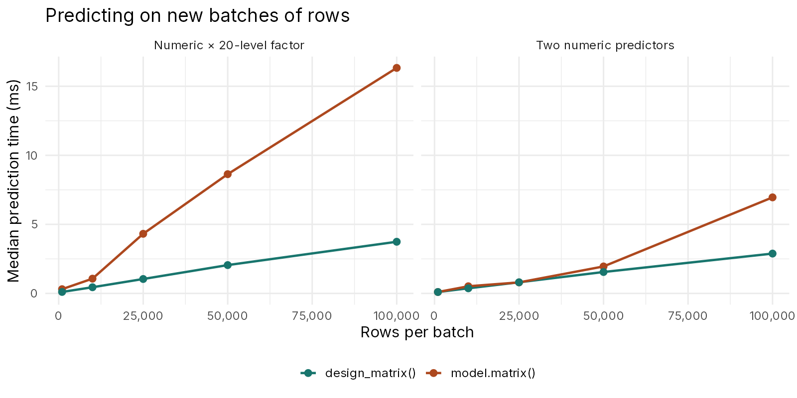
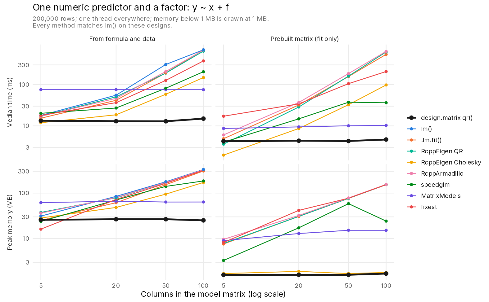
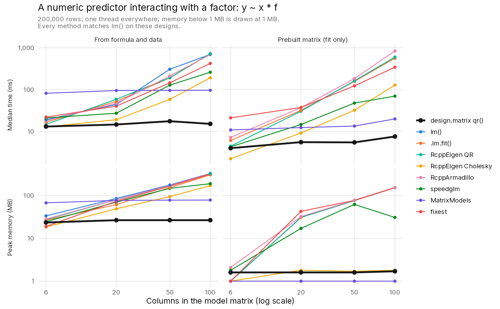
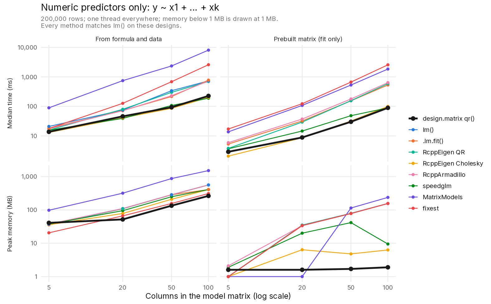
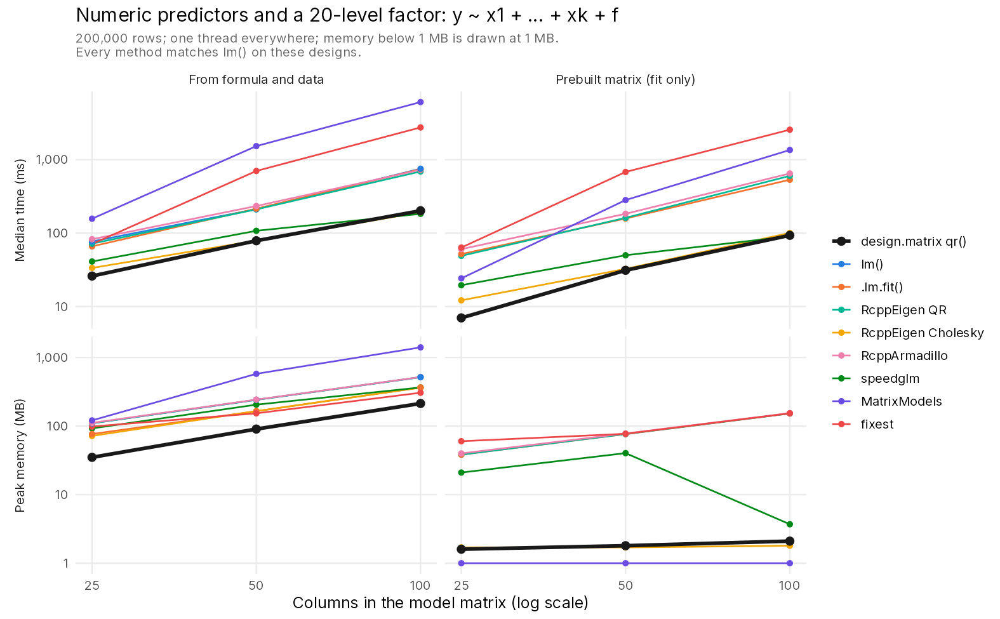

---
format:
  gfm:
    wrap: none
execute:
  warning: false
  message: false
knitr:
  opts_chunk:
    comment: "#>"
    collapse: true
---

```{r}
#| include: false
options(width = 200)
## Benchmarks build the model frame exactly as model.matrix() does, so that
## comparisons with functions that call it are fair.
options(design.matrix.skip_na_copy = FALSE)
```

# design.matrix

## Introduction

The `design.matrix` package builds model matrices that are identical, bit for bit, to those returned by `stats::model.matrix()`. Its main benefit comes when the dense model matrix is only an intermediate input to something else: least squares coefficients need `X'X` and `X'y`, predictions multiply it by a vector of coefficients, their standard errors need a quadratic form, and cluster-robust variances need weighted sums of its rows by group. `design.matrix` computes these results directly from the factor codes and numeric variables, without materializing the dense matrix, which often saves an order of magnitude or more in both time and memory. When the dense matrix itself is what you need, there is no step to skip, and the gains are much smaller.

```{r}
#| include: false
# Benchmarks for the summary table, on the data of the sections below.
library(design.matrix)
design_threads(1)
options(design.matrix.dedup = FALSE)
set.seed(1)
n <- 2e5
big <- data.frame(
    y = rnorm(n),
    x = rnorm(n),
    f1 = factor(sample(sprintf("a%02d", 1:50), n, TRUE)),
    f2 = factor(sample(letters[1:20], n, TRUE)),
    cl = sample(1:1000, n, TRUE))
fo <- y ~ x * f1 + f2
fit_big <- lm(fo, big)
spec_big <- design_matrix(fit_big, newdata = NULL)
w <- rnorm(n)
sfo <- y ~ x + f1 * f2
# Each expression runs once before it is timed (bench measures memory on the
# first timed run), so that a plan is prepared, as in repeated use.
warm_mark <- function(...) {
    exprs <- eval(substitute(alist(...)))
    for (e in exprs) invisible(eval(e, parent.frame()))
    bench::mark(..., iterations = 5, check = FALSE)
}
intro <- list(
    predict = warm_mark(
        predict(fit_big, big),
        drop(design_matrix(spec_big, big) %*% coef(fit_big))),
    se = warm_mark(
        predict(fit_big, big, se.fit = TRUE)$se.fit,
        sqrt(quadratic_diagonal(design_matrix(spec_big, big), vcov(fit_big)))),
    sums = warm_mark(
        rowsum(w * model.matrix(fo, big), big$cl),
        colSums(w * design_matrix(fo, big), group = big$cl)),
    sparse = warm_mark(
        Matrix::sparse.model.matrix(sfo, big),
        as(design_matrix(sfo, big), "CsparseMatrix")),
    ols = warm_mark(
        coef(lm(fo, big)),
        qr.coef(qr(design_matrix(fo, big)), big$y)))
cell <- function(task, i) {
    m <- intro[[task]]
    paste0(format(m$median[i]), ", ", format(m$mem_alloc[i]))
}
```

Use `design.matrix` when you have a formula (or fitted model) and data, and you need the model matrix only on the way to something else, so that allocating, filling, and storing it would be wasted work. If you already have the dense matrix `X`, use it directly.

```r
# install.packages("remotes")
remotes::install_github("vincentarelbundock/design.matrix")
```

How much time can you save when predicting on a new batch? The plot compares two numeric predictors with a numeric predictor interacting with a 20-level factor. Both methods reuse the fitted model’s terms, factor coding, and coefficients. Timing starts after one-time setup and includes multiplying by the coefficients. The package uses one thread.

```{r}
#| label: prediction-batch-timing
#| code-fold: true
#| code-summary: "Show benchmark code"
library(design.matrix)
library(ggplot2)
design_threads(1)
set.seed(27)

n <- 100000
d <- data.frame(x = rnorm(n), z = rnorm(n), region = factor(sample(1:20, n, replace = TRUE)))
train <- data.frame(x = rnorm(5000), z = rnorm(5000), region = factor(sample(1:20, 5000, replace = TRUE)))
train$y <- rnorm(nrow(train))
time_model <- function(formula) {
    fit <- lm(formula, train)
    tt <- delete.response(terms(fit))
    spec <- design_matrix(fit, newdata = NULL)
    beta <- coef(fit)

    base_predict <- function(batch) {
        mf <- model.frame(tt, batch, xlev = fit$xlevels)
        X <- model.matrix(tt, mf, contrasts.arg = fit$contrasts)
        drop(X %*% beta)
    }

    fast_predict <- function(batch) {
        D <- design_matrix(spec, batch)
        drop(D %*% beta)
    }

    time_batch <- function(n) {
        batch <- head(d, n)
        timings <- bench::mark(
            base_predict(batch), fast_predict(batch),
            iterations = 15, memory = FALSE, filter_gc = FALSE,
            check = function(a, b) isTRUE(all.equal(as.numeric(a), as.numeric(b))))
        data.frame(rows = n, ms = 1000 * as.numeric(timings$median),
                   method = c("model.matrix()", "design_matrix()"))
    }

    do.call(rbind, lapply(c(1000, 10000, 25000, 50000, 100000), time_batch))
}

times <- rbind(
    transform(time_model(y ~ x + z), model = "Two numeric predictors"),
    transform(time_model(y ~ x * region), model = "Numeric × 20-level factor"))
p <- ggplot(times, aes(rows, ms, colour = method)) +
    geom_line(linewidth = 1) + geom_point(size = 2.5) +
    facet_wrap(~ model) +
    expand_limits(y = 0) +
    scale_x_continuous(labels = scales::label_comma()) +
    scale_colour_manual(values = c("model.matrix()" = "#ad481e", "design_matrix()" = "#18756d")) +
    labs(title = "Predicting on new batches of rows",
         x = "Rows per batch", y = "Median prediction time (ms)", colour = NULL) +
    theme_minimal(base_size = 14) + theme(legend.position = "bottom")
ggsave("prediction-batch-timing.png", p, width = 10, height = 5, dpi = 160, bg = "white")
```




The plot measures only time, and only for predictions. The savings extend to memory and to other common tasks. On data with 200,000 rows and 119 columns, on one thread:

| Task | Base R | `design.matrix` |
|---|---|---|
| Predictions on new data | `r cell("predict", 1)` | `r cell("predict", 2)` |
| Standard errors of predictions | `r cell("se", 1)` | `r cell("se", 2)` |
| Grouped weighted sums (cluster-robust variance) | `r cell("sums", 1)` | `r cell("sums", 2)` |
| Sparse model matrix (vs. `Matrix::sparse.model.matrix()`) | `r cell("sparse", 1)` | `r cell("sparse", 2)` |
| Least squares coefficients (vs. `lm()`) | `r cell("ols", 1)` | `r cell("ols", 2)` |

Each of these tasks uses the model matrix only as an intermediate input, so `design.matrix` never forms it. When you do need the dense matrix, `design.matrix` returns the identical matrix at about the same speed on one thread and about twice as fast on four threads, but it takes the same memory. The benchmarks below give the details.

### Promises

1. **Exact.** Model matrices and those from `model.matrix()` pass `identical(a, b, num.eq = FALSE, single.NA = FALSE, attrib.as.set = FALSE)`, the strictest comparison R offers: same bits (signed zeros and `NA`/`NaN` payloads included), attributes in the same order, and the same warnings and errors, for any number of threads.
2. **New data.** A design built from a fitted model uses the same columns, factor coding, and transformations that the model uses for prediction.
3. **Algebra.** Products and sums computed without the dense matrix agree with the dense computation up to floating point rounding, with `NA` and `NaN` in the same places.
4. **Sparse.** Sparse model matrices hold the same non-zero values as the dense ones, bit for bit.

The test suite checks these on hundreds of random formulas and data sets.

### Performance

Under the hood, a design matrix stores only the factor codes, the numeric variables and the contrast matrices, which can take much less memory than the dense matrix. Products, sums and quadratic forms are computed by C kernels that read each row's few non-zero entries straight from these inputs, optionally on several threads, and rows with identical inputs can be computed once. When the dense matrix is needed, it is filled by a multi-threaded port of R's own C routine.

Each section shows a small example, checked with `identical()` when the result is exact and with `all.equal()` when sums run in a different order, followed by a benchmark on medium-sized data (200,000 rows, 119 columns). The relative costs depend on the size and structure of the design.

The benchmark tables report minimum and median elapsed time and `mem_alloc`, the total bytes allocated on the R heap during one evaluation. Reproducing the memory column requires an R build with `capabilities("profmem")` enabled. For fair comparisons with functions that call `model.matrix()`, the benchmarks set `options(design.matrix.skip_na_copy = FALSE)`, so that the model frame is built in exactly the same way (by default, `design.matrix` skips a copy of the frame that `na.omit()` makes even when no row has a missing value).

### Simple example

Build a design with an intercept, a numeric predictor, and a two-level factor. Multiplying it by a coefficient vector gives one linear prediction per row.

```{r}
library(design.matrix)

d <- data.frame(x = c(1, 2, 3), group = factor(c("a", "b", "a")))
D <- design_matrix(~ x + group, d)
beta <- c("(Intercept)" = 10, x = 2, groupb = -1)
drop(D %*% beta)

newdata <- data.frame(x = c(4, 5), group = "a")
D_new <- design_matrix(D, newdata)
drop(D_new %*% beta)
```

## Operations

### `design_matrix()`

A design matrix holds the prepared variables and the layout of the columns, but not the dense matrix. `as.matrix()` builds the latter.

```{r}
library(design.matrix)
d <- data.frame(
    y = c(0.3, -1.2, 0.8, 1.5, -0.4, 0.9, -2.1, 0.2),
    x = c(-1.5, 0.2, 1.1, -0.3, 2.0, 0.7, -0.9, 1.4),
    f = factor(c("a", "b", "c", "a", "b", "c", "a", "b")),
    cl = c(1, 1, 2, 2, 3, 3, 4, 4))

D <- design_matrix(y ~ x * f, d)
D

a <- model.matrix(y ~ x * f, d)
b <- as.matrix(D)
identical(a, b, num.eq = FALSE)
```

The following construction benchmark uses one thread. Building the design defers the cost of allocating and filling the dense matrix until `as.matrix()` is called; the next section times that step.

```{r}
library(design.matrix)
design_threads(1)
options(design.matrix.dedup = FALSE)
set.seed(1)
n <- 2e5
big <- data.frame(
    y = rnorm(n),
    x = rnorm(n),
    f1 = factor(sample(sprintf("a%02d", 1:50), n, TRUE)),
    f2 = factor(sample(letters[1:20], n, TRUE)),
    cl = sample(1:1000, n, TRUE))
fo <- y ~ x * f1 + f2

bench::mark(
    "stats::model.matrix" = model.matrix(fo, big),
    "design_matrix"       = design_matrix(fo, big),
    iterations = 10, check = FALSE)[c("expression", "min", "median", "mem_alloc")]
```

### Using multiple threads with `as.matrix()`

Writing the dense output accounts for much of the work in both implementations. Additional threads can speed things up (see `design_threads()`). The memory column includes both the dense output and temporary allocations made while building it.

```{r}
library(design.matrix)
options(design.matrix.dedup = FALSE)
set.seed(1)
n <- 2e5
big <- data.frame(
    y = rnorm(n),
    x = rnorm(n),
    f1 = factor(sample(sprintf("a%02d", 1:50), n, TRUE)),
    f2 = factor(sample(letters[1:20], n, TRUE)),
    cl = sample(1:1000, n, TRUE))
fo <- y ~ x * f1 + f2
same <- function(a, b) identical(a, b, num.eq = FALSE, single.NA = FALSE, attrib.as.set = FALSE)

fast_model_matrix <- function(formula, data, threads) {
    design_threads(threads)
    as.matrix(design_matrix(formula, data))
}

bench::mark(
    model.matrix(fo, big),
    fast_model_matrix(fo, big, threads = 1),
    fast_model_matrix(fo, big, threads = 4),
    iterations = 10, check = same)[c("expression", "min", "median", "mem_alloc")]
design_threads(1)
```

### Reusing a design on new data

To make predictions, new rows must be turned into columns exactly as the training rows were. Here, `poly(x, 2)` must use the training polynomial, and `f` must keep one column per training level even though the new data only contain `"b"`. Pass the training design and the new data to `design_matrix()`, then use `as.matrix()` to display the columns.

```{r}
library(design.matrix)
d <- data.frame(
    y = c(0.3, -1.2, 0.8, 1.5, -0.4, 0.9, -2.1, 0.2),
    x = c(-1.5, 0.2, 1.1, -0.3, 2.0, 0.7, -0.9, 1.4),
    f = factor(c("a", "b", "c", "a", "b", "c", "a", "b")),
    cl = c(1, 1, 2, 2, 3, 3, 4, 4))

D <- design_matrix(y ~ poly(x, 2) + f, d)
nd <- data.frame(x = c(0, 1), f = "b")
as.matrix(design_matrix(D, nd))
```

A fitted model works too, and gives the same result:

```{r}
fit <- lm(y ~ poly(x, 2) + f, d)
identical(as.matrix(design_matrix(D, nd)), as.matrix(design_matrix(fit, newdata = nd)), num.eq = FALSE)
```

When you have many batches, prepare once with `spec <- design_matrix(fit, newdata = NULL)`, then call `design_matrix(spec, batch)` for each batch. The benchmark below does this for a 100-row batch.

```{r}
library(design.matrix)
options(design.matrix.dedup = FALSE)
set.seed(1)
n <- 2e5
big <- data.frame(
    y = rnorm(n),
    x = rnorm(n),
    f1 = factor(sample(sprintf("a%02d", 1:50), n, TRUE)),
    f2 = factor(sample(letters[1:20], n, TRUE)),
    cl = sample(1:1000, n, TRUE))
fo <- y ~ x * f1 + f2
same <- function(a, b) identical(a, b, num.eq = FALSE, single.NA = FALSE, attrib.as.set = FALSE)

fit <- lm(fo, big)
spec <- design_matrix(fit, newdata = NULL)
tt <- delete.response(terms(fit))
nd <- big[1:100, ]
base_model_matrix <- function(batch) {
    mf <- model.frame(tt, batch, xlev = fit$xlevels, na.action = na.pass)
    model.matrix(tt, mf, contrasts.arg = fit$contrasts)
}
fast_model_matrix <- function(batch) {
    as.matrix(design_matrix(spec, batch))
}

bench::mark(
    base_model_matrix(nd),
    fast_model_matrix(nd),
    iterations = 200, check = same)[c("expression", "min", "median", "mem_alloc")]
```

### Arithmetic

Multiply or divide a design matrix by a number to scale it, or by a vector to scale each row. You can also add or subtract two designs with matching rows and columns. The result is another design matrix.

```{r}
library(design.matrix)
D <- design_matrix(~ x, data.frame(x = c(2, 3)))
as.matrix(c(1, 2) * D)
```

### `%*%`

`D %*% B` computes `X B` from the factor codes and numeric variables. `B` can have several columns.

```{r}
library(design.matrix)
d <- data.frame(
    y = c(0.3, -1.2, 0.8, 1.5, -0.4, 0.9, -2.1, 0.2),
    x = c(-1.5, 0.2, 1.1, -0.3, 2.0, 0.7, -0.9, 1.4),
    f = factor(c("a", "b", "c", "a", "b", "c", "a", "b")),
    cl = c(1, 1, 2, 2, 3, 3, 4, 4))
D <- design_matrix(y ~ x * f, d)

M <- model.matrix(y ~ x * f, d)
beta <- c(1, 0.5, -1, 2, 0.1, 0.3)

a <- M %*% beta
b <- D %*% beta
all.equal(a, b, check.attributes = FALSE)
```

The benchmarks in this section and the following ones time each operation in two situations. Starting from the data, both sides build their matrix and then use it once, as when predicting on new data. Starting from a prebuilt matrix (`X` or `DX`, built in the setup), only the operation is timed, as when the same matrix is reused; the prebuilt design typically uses less memory than the dense matrix.

```{r}
library(design.matrix)
options(design.matrix.dedup = FALSE)
set.seed(1)
n <- 2e5
big <- data.frame(
    y = rnorm(n),
    x = rnorm(n),
    f1 = factor(sample(sprintf("a%02d", 1:50), n, TRUE)),
    f2 = factor(sample(letters[1:20], n, TRUE)),
    cl = sample(1:1000, n, TRUE))
fo <- y ~ x * f1 + f2
X <- model.matrix(fo, big)
DX <- design_matrix(fo, big)
flat <- function(v) unname(c(unlist(v)))
close <- function(a, b) isTRUE(all.equal(flat(a), flat(b)))

beta <- rnorm(ncol(X))
bench::mark(
    "model.matrix, then %*%"  = model.matrix(fo, big) %*% beta,
    "design_matrix, then %*%" = design_matrix(fo, big) %*% beta,
    "prebuilt X"              = X %*% beta,
    "prebuilt design matrix"  = DX %*% beta,
    iterations = 10, check = close)[c("expression", "min", "median", "mem_alloc")]
```

### `crossprod()`

`crossprod(D, W)` computes `X'W`, such as `X'y` in least squares or weighted sums of the columns of `X`. `crossprod(D)` computes `X'X`, and `crossprod(D, w * D)` the weighted `X'WX`; both return ordinary matrices, which go straight to `chol()`, `chol2inv()`, `eigen()` or `solve()`.

```{r}
library(design.matrix)
d <- data.frame(
    y = c(0.3, -1.2, 0.8, 1.5, -0.4, 0.9, -2.1, 0.2),
    x = c(-1.5, 0.2, 1.1, -0.3, 2.0, 0.7, -0.9, 1.4),
    f = factor(c("a", "b", "c", "a", "b", "c", "a", "b")),
    cl = c(1, 1, 2, 2, 3, 3, 4, 4))
M <- model.matrix(y ~ x * f, d)
D <- design_matrix(y ~ x * f, d)

w <- seq(-1, 1, length.out = 8)

a <- crossprod(M, w)
b <- crossprod(D, w)
all.equal(a, b, check.attributes = FALSE)

all.equal(crossprod(M), crossprod(D))
all.equal(crossprod(M, w * M), crossprod(D, w * D))
```

```{r}
library(design.matrix)
options(design.matrix.dedup = FALSE)
set.seed(1)
n <- 2e5
big <- data.frame(
    y = rnorm(n),
    x = rnorm(n),
    f1 = factor(sample(sprintf("a%02d", 1:50), n, TRUE)),
    f2 = factor(sample(letters[1:20], n, TRUE)),
    cl = sample(1:1000, n, TRUE))
fo <- y ~ x * f1 + f2
X <- model.matrix(fo, big)
DX <- design_matrix(fo, big)
flat <- function(v) unname(c(unlist(v)))
close <- function(a, b) isTRUE(all.equal(flat(a), flat(b)))

w <- rnorm(n)
bench::mark(
    "model.matrix, then crossprod"  = crossprod(model.matrix(fo, big), w),
    "design_matrix, then crossprod" = crossprod(design_matrix(fo, big), w),
    "prebuilt X"                    = crossprod(X, w),
    "prebuilt design matrix"        = crossprod(DX, w),
    iterations = 10, check = close)[c("expression", "min", "median", "mem_alloc")]
```

For `X'X`, the design matrix adds up the products of each row's few non-zero entries, instead of all `p^2 / 2` products of the dense row.

```{r}
library(design.matrix)
options(design.matrix.dedup = FALSE)
set.seed(1)
n <- 2e5
big <- data.frame(
    y = rnorm(n),
    x = rnorm(n),
    f1 = factor(sample(sprintf("a%02d", 1:50), n, TRUE)),
    f2 = factor(sample(letters[1:20], n, TRUE)),
    cl = sample(1:1000, n, TRUE))
fo <- y ~ x * f1 + f2
X <- model.matrix(fo, big)
DX <- design_matrix(fo, big)
flat <- function(v) unname(c(unlist(v)))
close <- function(a, b) isTRUE(all.equal(flat(a), flat(b)))

bench::mark(
    "model.matrix, then crossprod"  = crossprod(model.matrix(fo, big)),
    "design_matrix, then crossprod" = crossprod(design_matrix(fo, big)),
    "prebuilt X"                    = crossprod(X),
    "prebuilt design matrix"        = crossprod(DX),
    iterations = 10, check = close)[c("expression", "min", "median", "mem_alloc")]
```

### `qr()`

`qr(D)` decomposes a design matrix without forming `X` or `Q`, and the usual functions accept the result: `qr.coef()`, `qr.fitted()`, `qr.resid()`, `qr.qty()`, `qr.qy()`, `qr.Q()`, `qr.R()` and `solve()`. `R` is the Cholesky factor of `crossprod(D)`, with columns pivoted as in `qr()` and `lm()`, and `Q` is `X R^-1`, never formed. Coefficients are refined from the residuals `y - X b`, which recovers much of the accuracy that the normal equations lose on badly conditioned designs. Columns whose residual norm is close to the tolerance are checked against the data, so aliased columns are those of `qr()`.

Results agree with `qr(as.matrix(D))` up to floating point rounding, not bit for bit. Signs of the rows of `R` (and of the columns of `Q`) can differ, and `qr.Q()` and `qr.qty()` return only the first `rank` columns or rows, since the complete `Q` is never formed. See `?design_qr`.

```{r}
library(design.matrix)
d <- data.frame(
    y = c(0.3, -1.2, 0.8, 1.5, -0.4, 0.9, -2.1, 0.2),
    x = c(-1.5, 0.2, 1.1, -0.3, 2.0, 0.7, -0.9, 1.4),
    f = factor(c("a", "b", "c", "a", "b", "c", "a", "b")),
    cl = c(1, 1, 2, 2, 3, 3, 4, 4))
M <- model.matrix(y ~ x * f, d)
D <- design_matrix(y ~ x * f, d)

a <- qr(M)
b <- qr(D)
b
all.equal(qr.coef(a, d$y), qr.coef(b, d$y))
all.equal(qr.resid(a, d$y), qr.resid(b, d$y), check.attributes = FALSE)
all.equal(abs(qr.R(a)), abs(qr.R(b)), check.attributes = FALSE)
```

### `colSums()`, `colMeans()`, `rowSums()` and `rowMeans()`

The row and column summaries of base R work on design matrices. Pass one group label per row to `colSums()` or `colMeans()` to get one row per group, as with `base::rowsum()`. Group sums are a building block of cluster-robust standard errors and subgroup averages.

```{r}
library(design.matrix)
d <- data.frame(site = c("B", "A", "B", "B", "A"), x = c(2, 10, 4, 6, 20))
D <- design_matrix(~ x, d)

colMeans(D)
colSums(D, group = d$site)
colMeans(D, group = d$site)

all.equal(colSums(D, group = d$site), rowsum(model.matrix(~ x, d), d$site))
```

The benchmark computes weighted group sums. To weight the rows, multiply the design by a vector first.

```{r}
library(design.matrix)
options(design.matrix.dedup = FALSE)
set.seed(1)
n <- 2e5
big <- data.frame(
    y = rnorm(n),
    x = rnorm(n),
    f1 = factor(sample(sprintf("a%02d", 1:50), n, TRUE)),
    f2 = factor(sample(letters[1:20], n, TRUE)),
    cl = sample(1:1000, n, TRUE))
fo <- y ~ x * f1 + f2
X <- model.matrix(fo, big)
DX <- design_matrix(fo, big)
flat <- function(v) unname(c(unlist(v)))
close <- function(a, b) isTRUE(all.equal(flat(a), flat(b)))

w <- rnorm(n)
bench::mark(
    "model.matrix, then rowsum"   = rowsum(w * model.matrix(fo, big), big$f2),
    "design_matrix, then colSums" = colSums(w * design_matrix(fo, big), group = big$f2),
    "prebuilt X"                  = rowsum(w * X, big$f2),
    "prebuilt design matrix"      = colSums(w * DX, group = big$f2),
    iterations = 10, check = close)[c("expression", "min", "median", "mem_alloc")]
```

### `quadratic_diagonal()`

A common task is to extract the diagonal of `X V X'`. For example, in a linear regression context, with `V` the variance-covariance matrix of the coefficients and `X` the design matrix, the diagonal holds the variance of each fitted value, and its square root is the standard error. With `V = solve(crossprod(X))` instead, the diagonal holds the leverage of each observation. `quadratic_diagonal()` computes this diagonal without forming `X` or the full `n` by `n` product.

```{r}
library(design.matrix)
d <- data.frame(
    y = c(0.3, -1.2, 0.8, 1.5, -0.4, 0.9, -2.1, 0.2),
    x = c(-1.5, 0.2, 1.1, -0.3, 2.0, 0.7, -0.9, 1.4),
    f = factor(c("a", "b", "c", "a", "b", "c", "a", "b")),
    cl = c(1, 1, 2, 2, 3, 3, 4, 4))
M <- model.matrix(y ~ x * f, d)
D <- design_matrix(y ~ x * f, d)

V <- diag(6) / 10

a <- rowSums((M %*% V) * M)
b <- quadratic_diagonal(D, V)
all.equal(a, b, check.attributes = FALSE)
```

Base R builds an `n` by `p` intermediate; the kernel touches only the non-zero entries of each row.

```{r}
library(design.matrix)
options(design.matrix.dedup = FALSE)
set.seed(1)
n <- 2e5
big <- data.frame(
    y = rnorm(n),
    x = rnorm(n),
    f1 = factor(sample(sprintf("a%02d", 1:50), n, TRUE)),
    f2 = factor(sample(letters[1:20], n, TRUE)),
    cl = sample(1:1000, n, TRUE))
fo <- y ~ x * f1 + f2
X <- model.matrix(fo, big)
DX <- design_matrix(fo, big)
flat <- function(v) unname(c(unlist(v)))
close <- function(a, b) isTRUE(all.equal(flat(a), flat(b)))

V <- crossprod(matrix(rnorm(ncol(X)^2), ncol(X))) / ncol(X)
base_diagonal <- function(X, V) rowSums((X %*% V) * X)

bench::mark(
    base_diagonal(model.matrix(fo, big), V),
    quadratic_diagonal(design_matrix(fo, big), V),
    base_diagonal(X, V),
    quadratic_diagonal(DX, V),
    iterations = 5, check = close)[c("expression", "min", "median", "mem_alloc")]
```

### Sparse model matrix

`as(D, "CsparseMatrix")` builds a sparse matrix without forming the dense one. It is identical to converting the dense model matrix.

```{r}
library(design.matrix)
library(Matrix)
d <- data.frame(
    y = c(0.3, -1.2, 0.8, 1.5, -0.4, 0.9, -2.1, 0.2),
    x = c(-1.5, 0.2, 1.1, -0.3, 2.0, 0.7, -0.9, 1.4),
    f = factor(c("a", "b", "c", "a", "b", "c", "a", "b")),
    cl = c(1, 1, 2, 2, 3, 3, 4, 4))
M <- model.matrix(y ~ x * f, d)
D <- design_matrix(y ~ x * f, d)

dense_to_sparse <- function(M) as(as(as(M, "dMatrix"), "generalMatrix"), "CsparseMatrix")
a <- dense_to_sparse(M)
b <- as(D, "CsparseMatrix")
identical(a, b)
```

`Matrix::sparse.model.matrix()` and `MatrixModels::model.Matrix()` are shown for reference: they have their own rules for contrasts and column names. This benchmark uses a factor interaction and checks that all four methods produce the same dimensions and entries.

```{r}
library(design.matrix)
library(Matrix)
library(MatrixModels)
options(design.matrix.dedup = FALSE)
set.seed(1)
n <- 2e5
big <- data.frame(
    y = rnorm(n),
    x = rnorm(n),
    f1 = factor(sample(sprintf("a%02d", 1:50), n, TRUE)),
    f2 = factor(sample(letters[1:20], n, TRUE)),
    cl = sample(1:1000, n, TRUE))
base_sparse <- function(formula, data) {
    X <- model.matrix(formula, data)
    as(as(as(X, "dMatrix"), "generalMatrix"), "CsparseMatrix")
}
fast_sparse <- function(formula, data) {
    D <- design_matrix(formula, data)
    as(D, "CsparseMatrix")
}

sfo <- y ~ x + f1 * f2
reference <- fast_sparse(sfo, big)
same_entries <- function(x) {
    identical(dim(x), dim(reference)) && Matrix::nnzero(x - reference) == 0
}
stopifnot(
    identical(base_sparse(sfo, big), reference),
    same_entries(Matrix::sparse.model.matrix(sfo, big)),
    same_entries(MatrixModels::model.Matrix(sfo, big, sparse = TRUE)))
bench::mark(
    base_sparse(sfo, big),
    fast_sparse(sfo, big),
    Matrix::sparse.model.matrix(sfo, big),
    MatrixModels::model.Matrix(sfo, big, sparse = TRUE),
    iterations = 5, check = FALSE)[c("expression", "min", "median", "mem_alloc")]
```

### Repeated rows

When rows have identical predictor values, `design.matrix` can compute the result once per distinct row and reuse it for every matching row. Row-wise results stay identical bit for bit. The option `design.matrix.dedup` controls this: `"auto"` (default), `TRUE` (always) or `FALSE` (never).

Repeated rows are found once per design matrix and remembered, so the first call pays for the search. The first two timings include design construction. The cached timing reuses both the design and its groups. Here, 5,000 patterns repeat over 200,000 rows.

```{r}
library(design.matrix)
options(design.matrix.dedup = FALSE)
set.seed(1)
n <- 2e5
dup <- data.frame(
    f1 = factor(sample.int(50, n, TRUE)),
    f3 = factor(sample.int(5, n, TRUE)),
    f2 = factor(sample.int(20, n, TRUE)))
pd <- design_matrix(~ f1 * f3 + f2, dup, contrasts.arg = list(f1 = "contr.sum", f3 = "contr.sum"))
Vd <- diag(ncol(design_matrix(pd, dup[1:2, ])))
same <- function(a, b) identical(a, b, num.eq = FALSE, single.NA = FALSE, attrib.as.set = FALSE)

quad <- function(mode, D = design_matrix(pd, dup)) {
    op <- options(design.matrix.dedup = mode)
    on.exit(options(op))
    quadratic_diagonal(D, Vd)
}
D_cached <- design_matrix(pd, dup)
invisible(quad("auto", D_cached))
bench::mark(
    "every row"              = quad(FALSE),
    "grouped, first call"    = quad("auto"),
    "grouped, groups cached" = quad("auto", D_cached),
    iterations = 5, check = same)[c("expression", "min", "median", "mem_alloc")]
```

### Out-of-core data

When the data are too large for memory, pass a DuckDB connection and a table (or a `sql` query), or the path of Parquet files, instead of a data frame. The rows stay in the database. `crossprod()`, `colSums()` and `colMeans()` (with `group =` a column) run there as `GROUP BY` aggregates over factor codes and products of numeric variables, followed by small products with the contrast matrices in R. `D %*% beta` writes the predictions to a temporary view and returns its name. Factor levels are pinned in R, with R's sorting rules, and rows with missing values are dropped, as `na.omit()` drops them.

```{r}
library(design.matrix)
con <- DBI::dbConnect(duckdb::duckdb())
d <- data.frame(
    y = c(0.3, -1.2, 0.8, 1.5, -0.4, 0.9, -2.1, 0.2),
    x = c(-1.5, 0.2, 1.1, -0.3, 2.0, 0.7, -0.9, 1.4),
    f = c("a", "b", "c", "a", "b", "c", "a", "b"))
DBI::dbWriteTable(con, "d", d)

D <- design_matrix(y ~ x + f + log(x + 3), con, table = "d")
D
m <- design_moments(D) # X'X, X'y, y'y and n, computed in DuckDB
beta <- solve(m$xtx, m$xty)
all.equal(drop(beta), coef(lm(y ~ x + f + log(x + 3), d)), check.attributes = FALSE)

p <- D %*% beta
as.data.frame(p)
```

The SQL engine handles factors, character and logical columns, numeric columns, interactions, and arithmetic with `log()`, `exp()`, `sqrt()` and `abs()`. Any other formula, such as one with `poly()` or `splines::ns()`, uses the chunked engine: batches of rows go through `design_matrix(spec, batch)`, and the results are accumulated. `design_explain(D)` shows which terms prevent the SQL engine. To fit in R and score in the database, pass a design or a fitted model instead of the formula: `design_matrix(fit, con, table = "new_rows") %*% coef(fit)`. Remote designs keep only the algebra promise (agreement up to rounding), and `as.matrix()` refuses to collect more than 100,000 rows unless `force = TRUE`.

```{r}
#| include: false
DBI::dbDisconnect(con)
```

## Recipes

### Least squares

Least squares coefficients only need `X'X` and `X'y`, so `qr()` on a design matrix gives them without forming the dense matrix. With weights, use `qr(sqrt(w) * D)` and `sqrt(w) * y`.

```{r}
library(design.matrix)
d <- data.frame(
    y = c(0.3, -1.2, 0.8, 1.5, -0.4, 0.9, -2.1, 0.2),
    x = c(-1.5, 0.2, 1.1, -0.3, 2.0, 0.7, -0.9, 1.4),
    f = factor(c("a", "b", "c", "a", "b", "c", "a", "b")),
    cl = c(1, 1, 2, 2, 3, 3, 4, 4))

fit <- lm(y ~ x + f, d)
D <- design_matrix(y ~ x + f, d)
all.equal(coef(fit), qr.coef(qr(D), d$y))
```

The benchmarks below compare `qr()` on a design matrix with eight other implementations of least squares, on 200,000 rows. Each figure is one family of designs whose structure stays fixed while the number of columns grows, so that each line shows how a method scales with width. The benchmark runs outside this README, because a fair comparison needs a fresh R process for each method and design: `bench/ols/run.sh` runs it and writes `bench/ols/results.csv`, which the figures and tables read. The protocol:

* Two comparisons. *From formula*: every method starts from the formula and the data, as a user would. *Prebuilt*: the model matrix (or design matrix) is built before timing, and only the fit is timed.
* One thread everywhere, including the BLAS, and every process on the same fast core of the CPU (this machine has fast and compact cores). The model frame is built exactly as `model.matrix()` builds it (option `design.matrix.skip_na_copy = FALSE`).
* Time is the median of 3 to 11 calls (up to about 3 seconds per method), each after a garbage collection, so that every call starts from the same state. Memory is the peak resident memory of the first call in a fresh process, so it counts every allocation, including those made in C++.
* Every result is compared with the coefficients of `lm()`, including which columns are aliased (`NA`). Every method matches `lm()` on the designs in the figures; the rank-deficient design below is where they differ.

```{r}
#| include: false
source("bench/ols/plot.R")
ols_figures()
```

When most columns come from factors, the design matrix computes `X'X` from sums within factor levels and never touches the zeros of the dummy columns. Its time and memory barely grow with the number of levels:





Numeric predictors have no such structure: `X'X` needs the same arithmetic however it is organized, and the design matrix hands it to the BLAS, block by block, without forming `X`. Times are close to those of the fastest dense methods, with less memory from formula:





With 49 columns of which 6 are aliased (`y ~ x + f1 * f3`, where some combinations of levels never occur), the methods that match `lm()` are the design matrix, `speedglm`, `lm()` and `.lm.fit()`; the others stop with an error, drop the aliased columns, or return a different solution.

```{r}
#| echo: false
#| results: asis
res <- read.csv("bench/ols/results.csv")
ali <- res[res$family == "aliased", ]
ali$cell <- ifelse(is.na(ali$ms), paste("error:", ali$note),
                   sprintf("%s ms, %s MB%s", format(ali$ms, big.mark = ",", trim = TRUE), round(ali$MB),
                           ifelse(ali$matches_lm %in% TRUE, "", " (different answer)")))
tab <- reshape(ali[, c("method", "mode", "cell")], idvar = "method", timevar = "mode", direction = "wide")
names(tab) <- c("Method", "From formula", "Prebuilt")
tab$Prebuilt[is.na(tab$Prebuilt)] <- "(no matrix interface)"
tab <- tab[order(tab$Method != "design.matrix qr()", tab$Method), ]
print(knitr::kable(tab, row.names = FALSE))
```

In short:

* When most columns come from factors (the first two figures), `qr()` on a design matrix is 1.3 to 6 times faster than the fastest method that matches `lm()` from 20 columns on, from formula, and 1.7 to 2.6 times faster prebuilt, with flat memory.
* With numeric predictors (the next two figures), from 20 columns on, it is never more than about 20% slower than the fastest method, and up to 1.7 times faster when a factor is added; from formula, it uses less memory.
* On the smallest designs (5 or 6 columns), a fixed overhead of about 2 ms makes it slower than a dense Cholesky decomposition (`RcppEigen`), and `fixest` uses less memory from formula.
* With aliased columns, it is 5 times faster than the fastest other method that matches `lm()` from formula (`speedglm`), and 2.6 times faster prebuilt.

<details>
<summary>All results</summary>

```{r}
#| echo: false
#| results: asis
res <- read.csv("bench/ols/results.csv")
res <- res[res$family != "aliased", ]
for (fam in names(ols_families)) for (md in c("formula", "prebuilt")) {
    x <- res[res$family == fam & res$mode == md, ]
    x$cell <- ifelse(is.na(x$ms), "error",
                     sprintf("%s ms, %s MB%s", format(x$ms, big.mark = ",", trim = TRUE), round(x$MB),
                             ifelse(x$matches_lm %in% TRUE, "", " (different answer)")))
    tab <- reshape(x[, c("method", "p", "cell")], idvar = "method", timevar = "p", direction = "wide")
    names(tab) <- c("Method", paste(sort(unique(x$p)), "columns"))
    tab <- tab[order(tab$Method != "design.matrix qr()", tab$Method), ]
    cat(sprintf("\n**%s, %s**\n\n", ols_families[[fam]], if (md == "formula") "from formula" else "prebuilt"))
    print(knitr::kable(tab, row.names = FALSE))
}
cat("\n", paste(readLines("bench/ols/machine.txt"), collapse = "; "), "\n")
```

</details>

### Fitting linear models

`design_lm()` takes the arguments of `lm()` (`formula`, `data`, `subset`, `weights`, `na.action`, `offset`, `contrasts`) and fits the model on a design matrix, without forming the dense matrix. Coefficients, `vcov()` and `sigma()` agree with `lm()`, including the `NA` coefficients of aliased columns, and the usual methods work: `summary()`, `predict()` (with standard errors and intervals), `residuals()`, `fitted()`, `nobs()`, `logLik()`, `AIC()`. `design_lm_fit(D, y, weights, offset)` fits a design matrix you already have.

When many rows share a design pattern, as with categorical predictors, the fit only needs the count, the weighted mean and the sum of squares of the response in each pattern. `design_lm()` finds the patterns with the machinery of [repeated rows](#repeated-rows) and fits on them: here, 15 patterns instead of 100,000 rows. `compress = FALSE` turns this off.

```{r}
library(design.matrix)
set.seed(1)
n <- 1e5
d <- data.frame(
    x = rnorm(n),
    f = factor(sample(letters[1:5], n, TRUE)),
    g = factor(sample(c("lo", "mid", "hi"), n, TRUE)),
    w = runif(n))
d$y <- rnorm(n, mean = as.integer(d$f))

fit <- design_lm(y ~ f * g, d, weights = w)
fit$patterns
ref <- lm(y ~ f * g, d, weights = w)
all.equal(coef(fit), coef(ref))
all.equal(vcov(fit), vcov(ref))
all.equal(sigma(fit), sigma(ref))

fit <- design_lm(y ~ x * f, d)
all.equal(predict(fit, d[1:5, ], interval = "confidence"),
          predict(lm(y ~ x * f, d), d[1:5, ], interval = "confidence"))
```

### Predictions

The predictions of a linear model are `X b`, the design matrix times the coefficients.

```{r}
library(design.matrix)
d <- data.frame(
    y = c(0.3, -1.2, 0.8, 1.5, -0.4, 0.9, -2.1, 0.2),
    x = c(-1.5, 0.2, 1.1, -0.3, 2.0, 0.7, -0.9, 1.4),
    f = factor(c("a", "b", "c", "a", "b", "c", "a", "b")),
    cl = c(1, 1, 2, 2, 3, 3, 4, 4))

fast_predict <- function(fit, newdata) {
    D <- design_matrix(fit, newdata = newdata)
    drop(D %*% coef(fit))
}

fit <- lm(y ~ x + f, d)
a <- predict(fit, d)
b <- fast_predict(fit, d)
all.equal(a, b, check.attributes = FALSE)
```

```{r}
library(design.matrix)
options(design.matrix.dedup = FALSE)
set.seed(1)
n <- 2e5
big <- data.frame(
    y = rnorm(n),
    x = rnorm(n),
    f1 = factor(sample(sprintf("a%02d", 1:50), n, TRUE)),
    f2 = factor(sample(letters[1:20], n, TRUE)),
    cl = sample(1:1000, n, TRUE))
fo <- y ~ x * f1 + f2
close <- function(a, b) isTRUE(all.equal(unname(a), unname(b)))

fast_predict <- function(fit, newdata, spec) {
    D <- design_matrix(spec, newdata)
    drop(D %*% coef(fit))
}

fit_big <- lm(fo, big)
spec_big <- design_matrix(fit_big, newdata = NULL)
bench::mark(
    "predict(fit, newdata)" = predict(fit_big, big),
    "fast_predict"          = fast_predict(fit_big, big, spec_big),
    iterations = 5, check = close)[c("expression", "min", "median", "mem_alloc")]
```

### Standard errors of predictions

The standard errors of the predictions are the square roots of the diagonal of `X V X'`, where `V` is the variance-covariance matrix of the coefficients.

```{r}
library(design.matrix)
d <- data.frame(
    y = c(0.3, -1.2, 0.8, 1.5, -0.4, 0.9, -2.1, 0.2),
    x = c(-1.5, 0.2, 1.1, -0.3, 2.0, 0.7, -0.9, 1.4),
    f = factor(c("a", "b", "c", "a", "b", "c", "a", "b")),
    cl = c(1, 1, 2, 2, 3, 3, 4, 4))

base_predict_se <- function(fit, newdata) {
    predict(fit, newdata, se.fit = TRUE)$se.fit
}
fast_predict_se <- function(fit, newdata) {
    D <- design_matrix(fit, newdata = newdata)
    sqrt(quadratic_diagonal(D, vcov(fit)))
}

fit <- lm(y ~ x + f, d)
a <- base_predict_se(fit, d)
b <- fast_predict_se(fit, d)
all.equal(a, b, check.attributes = FALSE)
```

For this full-rank linear model, `predict(..., se.fit = TRUE)` returns predictions and standard errors. The helper computes only the standard errors and reuses a prepared design specification.

```{r}
library(design.matrix)
options(design.matrix.dedup = FALSE)
set.seed(1)
n <- 2e5
big <- data.frame(
    y = rnorm(n),
    x = rnorm(n),
    f1 = factor(sample(sprintf("a%02d", 1:50), n, TRUE)),
    f2 = factor(sample(letters[1:20], n, TRUE)),
    cl = sample(1:1000, n, TRUE))
fo <- y ~ x * f1 + f2
close <- function(a, b) isTRUE(all.equal(unname(a), unname(b)))

base_predict_se <- function(fit, newdata) {
    predict(fit, newdata, se.fit = TRUE)$se.fit
}
fast_predict_se <- function(fit, newdata, spec) {
    D <- design_matrix(spec, newdata)
    sqrt(quadratic_diagonal(D, vcov(fit)))
}

fit_big <- lm(fo, big)
spec_big <- design_matrix(fit_big, newdata = NULL)
bench::mark(
    base_predict_se(fit_big, big),
    fast_predict_se(fit_big, big, spec_big),
    iterations = 5, check = close)[c("expression", "min", "median", "mem_alloc")]
```

### Leverage

The hat values of a linear model are the diagonal of `X (X'X)^-1 X'`, and `(X'X)^-1` is `vcov(fit) / sigma(fit)^2`.

```{r}
library(design.matrix)
d <- data.frame(
    y = c(0.3, -1.2, 0.8, 1.5, -0.4, 0.9, -2.1, 0.2),
    x = c(-1.5, 0.2, 1.1, -0.3, 2.0, 0.7, -0.9, 1.4),
    f = factor(c("a", "b", "c", "a", "b", "c", "a", "b")),
    cl = c(1, 1, 2, 2, 3, 3, 4, 4))

fit <- lm(y ~ x + f, d)
D <- design_matrix(fit, newdata = d)
a <- hatvalues(fit)
b <- quadratic_diagonal(D, vcov(fit) / sigma(fit)^2)
all.equal(a, b, check.attributes = FALSE)
```

`hatvalues()` works from the QR decomposition stored in the fit. Both manual calculations start with a prebuilt design and the same precomputed inverse crossproduct.

```{r}
library(design.matrix)
options(design.matrix.dedup = FALSE)
set.seed(1)
n <- 2e5
big <- data.frame(
    y = rnorm(n),
    x = rnorm(n),
    f1 = factor(sample(sprintf("a%02d", 1:50), n, TRUE)),
    f2 = factor(sample(letters[1:20], n, TRUE)),
    cl = sample(1:1000, n, TRUE))
fo <- y ~ x * f1 + f2
fit_big <- lm(fo, big)
X <- model.matrix(fo, big)
D <- design_matrix(fo, big)
flat <- function(v) unname(c(unlist(v)))
close <- function(a, b) isTRUE(all.equal(flat(a), flat(b)))

XtXi <- vcov(fit_big) / sigma(fit_big)^2
base_leverage <- function(X, XtXi) {
    rowSums((X %*% XtXi) * X)
}
fast_leverage <- function(D, XtXi) {
    quadratic_diagonal(D, XtXi)
}

bench::mark(
    hatvalues(fit_big),
    base_leverage(X, XtXi),
    fast_leverage(D, XtXi),
    iterations = 5, check = close)[c("expression", "min", "median", "mem_alloc")]
```

### Cluster-robust standard errors

The cluster-robust covariance matrix is the sandwich `B M B`, with bread `B = (X'X)^-1` and meat `M = S'S`, where row `c` of `S` sums `e_i x_i` over the observations in cluster `c` (without a small-sample correction). The same function works on the dense model matrix and on the design matrix.

```{r}
library(design.matrix)
d <- data.frame(
    y = c(0.3, -1.2, 0.8, 1.5, -0.4, 0.9, -2.1, 0.2),
    x = c(-1.5, 0.2, 1.1, -0.3, 2.0, 0.7, -0.9, 1.4),
    f = factor(c("a", "b", "c", "a", "b", "c", "a", "b")),
    cl = c(1, 1, 2, 2, 3, 3, 4, 4))

base_cluster_vcov <- function(X, e, cluster, bread) {
    S <- rowsum(e * X, cluster)
    bread %*% crossprod(S) %*% bread
}
fast_cluster_vcov <- function(D, e, cluster, bread) {
    S <- colSums(e * D, group = cluster)
    bread %*% crossprod(S) %*% bread
}
fit <- lm(y ~ x + f, d)
D <- design_matrix(fit, newdata = d)
bread <- vcov(fit) / sigma(fit)^2
a <- base_cluster_vcov(model.matrix(fit), residuals(fit), d$cl, bread)
b <- fast_cluster_vcov(D, residuals(fit), d$cl, bread)
all.equal(a, b, check.attributes = FALSE)
```

```{r}
library(design.matrix)
options(design.matrix.dedup = FALSE)
set.seed(1)
n <- 2e5
big <- data.frame(
    y = rnorm(n),
    x = rnorm(n),
    f1 = factor(sample(sprintf("a%02d", 1:50), n, TRUE)),
    f2 = factor(sample(letters[1:20], n, TRUE)),
    cl = sample(1:1000, n, TRUE))
fo <- y ~ x * f1 + f2
fit_big <- lm(fo, big)
X <- model.matrix(fo, big)
D <- design_matrix(fo, big)
XtXi <- vcov(fit_big) / sigma(fit_big)^2
base_cluster_vcov <- function(X, e, cluster, bread) {
    S <- rowsum(e * X, cluster)
    bread %*% crossprod(S) %*% bread
}
fast_cluster_vcov <- function(D, e, cluster, bread) {
    S <- colSums(e * D, group = cluster)
    bread %*% crossprod(S) %*% bread
}
flat <- function(v) unname(c(unlist(v)))
close <- function(a, b) isTRUE(all.equal(flat(a), flat(b)))

e <- residuals(fit_big)
bench::mark(
    base_cluster_vcov(X, e, big$cl, XtXi),
    fast_cluster_vcov(D, e, big$cl, XtXi),
    iterations = 5, check = close)[c("expression", "min", "median", "mem_alloc")]
```

## Setup

```{r}
cat(R.version.string, "\n")
cat("cores:", parallel::detectCores(), "\n")
cat("BLAS:", basename(extSoftVersion()[["BLAS"]]), "\n")
```
